### Data Exfiltration Detection

## Overview

Data exfiltration is the unauthorized transfer of sensitive data from a computer or other device. It's a primary objective for attackers who have breached a network. As a SOC analyst, our job is to detect and stop this before sensitive information walks out the door. This room will cover the common techniques attackers use to steal data and, more importantly, how we can catch them in the act.

### Objective

- Understand the common methods used for data exfiltration.
- Learn how to detect exfiltration attempts using network traffic analysis.
- Identify signs of exfiltration on endpoint devices.
- Correlate logs in a SIEM to uncover hidden exfiltration channels.

## Tools Used
| Tool | Purpose |
|---|---|
| Splunk | SIEM to aggregate logs |
| Wireshark | Deep packet analysis |

---

## Data Exfil through DNS Tunneling

### Task 1 — What is the suspicious domain receiving the DNS traffic?
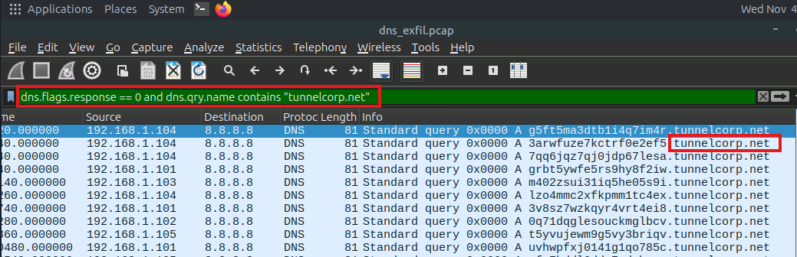

- Investigate DNS queries with no response, identify suspicious external domain.

### Task 2 — How many suspicious traffic/logs related to dns tunneling were observed?
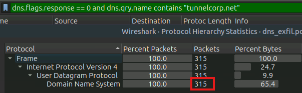

- Filter packet using dns.flags.response == 0 for no dns request with no response and dns.qry.name contains "tunnelcorp.net" to filter dns queries that contains tunnelcorp.net term.

### Task 3 — Which local IP sent the maximum number of suspicious requests?
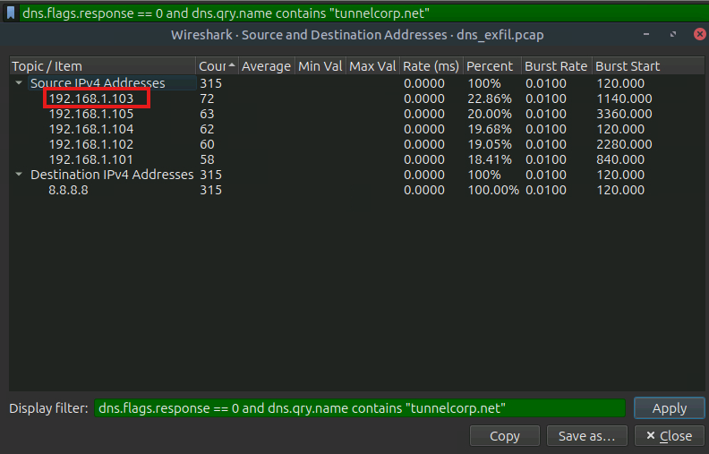

- Use statistics > IPv4 > Source and Destination addresses to summarize the request made and apply filter from Task 2. Sort by count in descending order.

## Data Exfil through FTP

## Notes

1. Detection method (server logs, SSH session metadata, netflow analysis)
2. Exfil vector (public or misconfigured internal servers, compromised credentials, non-standard ports to blend traffic)
3. Indicators (USER and PASS commands cleartext credentials, STOR upload and RETR download commands, Large data connections to sus IPs outside normal hours, Data channels opening on ephemeral ports (PASV) paired with large payloads.)

### Task 1 — How many connections were observed from the guest account?
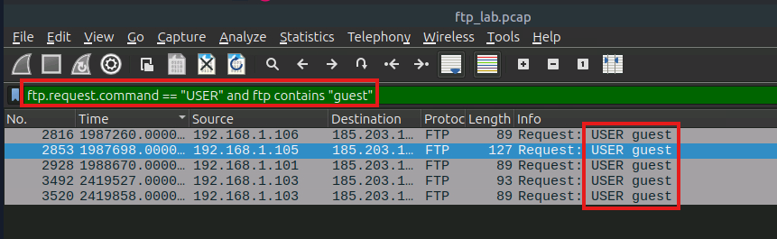

- Filter the packet for USER ftp request command and ftp contains the term "guest" to get the total number of connections by guest account.

### Task 2 — Apply the filter; what is the name of the customer-related file exfiltrated from the root account?
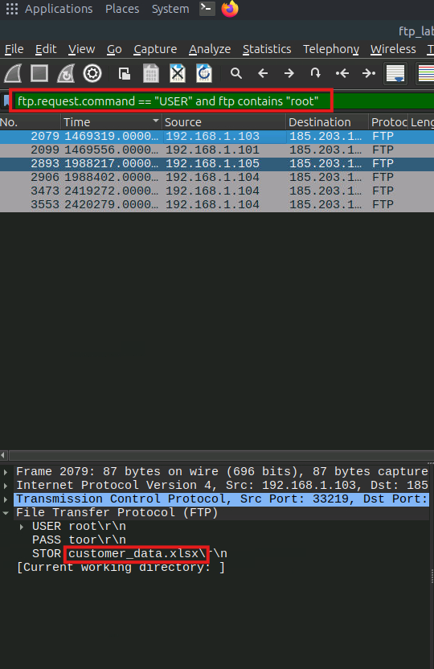

- Filter the packet for USER command and for ftp containing the term "root". Identify the file name that has been STOR-ed

### Task 3 — Which internal IP was found to be sending the largest payload to an external IP?
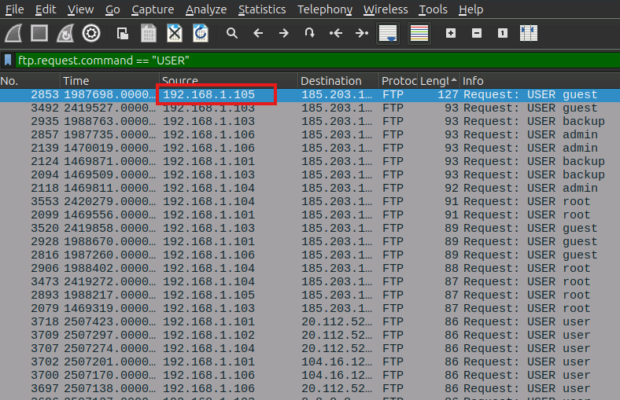

- Filter packet for USER command and sort by length

### Task 4 — What is the flag hidden inside the ftp stream transferring the CSV file to the suspicious IP?
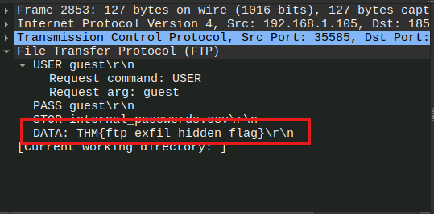

- Identify the flag in the following DATA field.

## Data Exfil through HTTP

## Notes

1. POST uploads to external servers
2. GET requests with encoded data
3. Use of common services / CDN
4. Custom headers (Data placed in headers (e.g., X-Data: <base64>) may bypass some string-based DLP)
5. Chunked transfer / multipart
6. HTTPS/TLS tunneling (The encrypted channel hides the payload; detection requires TLS inspection, SNI analysis, or metadata-based detection.)
7. Staging via cloud services
8. Detect by Unusually large HTTP POST requests, HTTP requests to domains with low reputation, Frequent small requests (beaconing) to the same host followed by large uploads and Chunked or multipart transfers where multiple requests compose a larger file.

### Task 1 — Which internal compromised host was used to exfiltrate this sensitive data?
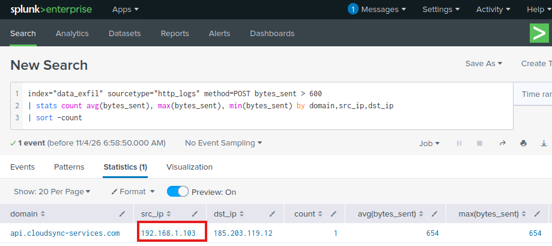
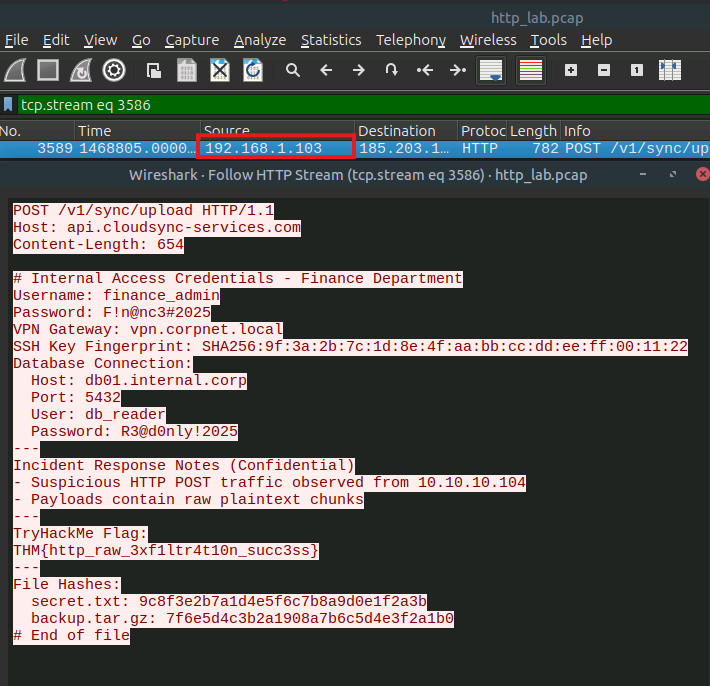

- In Splunk instance, identify post request with byte size greater than 600. One log entry exists, continue investigation in Wireshark. Filter by frame length and post request, identify the log that is filtered and proceed to follow HTTP stream. 

### Task - 2 What's the flag hidden inside the exfiltrated data?
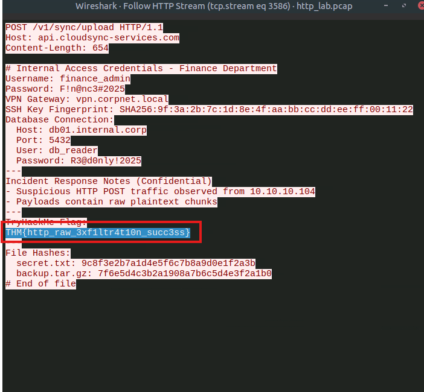

- The room flag is contained with the http stream. 

## Data Exfil through ICMP

## Notes

1. Common techniques (ICMP echo (type 8) / reply (type 0) tunneling, Custom ICMP types/codes using uncommon ICMP types or non-zero codes to avoid signature-based detections, Fragmentation and reassembly and Encryption/obfuscation)
2. IoAttacks (Persistent ICMP sessions to an external host, Unusually large ICMP payloads or frequent ICMP with payload > typical ping size, ICMP payloads that contain high-entropy data or patterns consistent with base64/hex, Bursts of ICMP are immediately followed by no other legitimate application traffic from the same host)
3. Wireshark IoAttacks (ICMP packet volumes, Large frame.len or icmp.payload (e.g., > 64 bytes), ICMP type/code unusual values, Regular timing (periodicity), Fragments with reassembly

### Task 1 — What is the flag found in the exfiltrated data through ICMP?
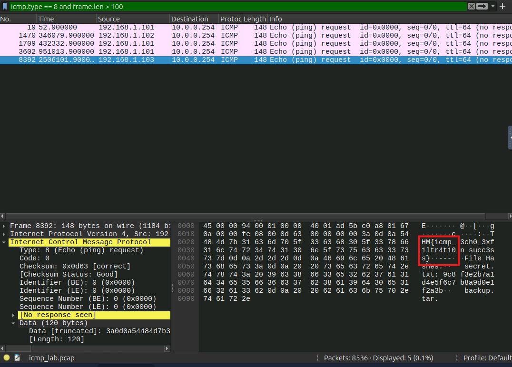

- 

---

## Key Takeaways

- **Takeaway 1** — 

### Practical Application

---
