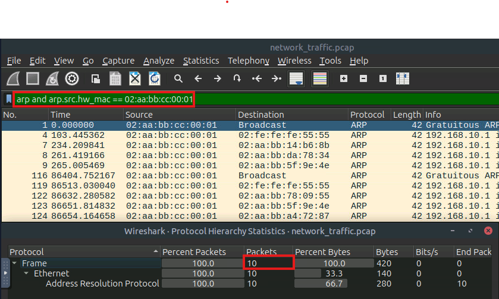
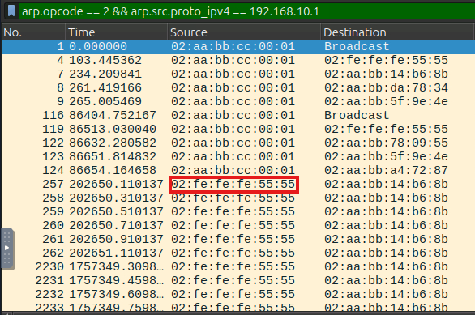
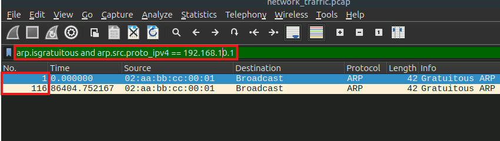
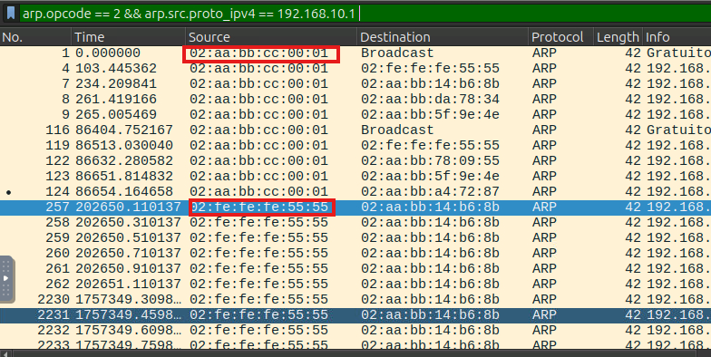
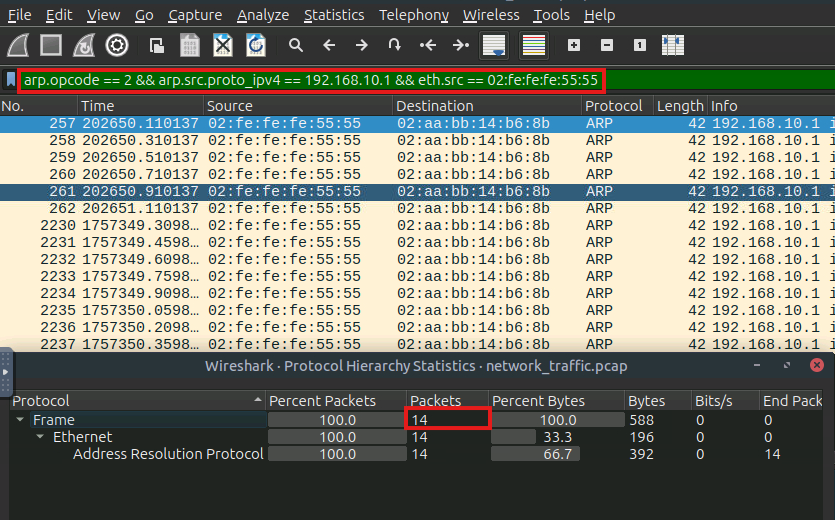
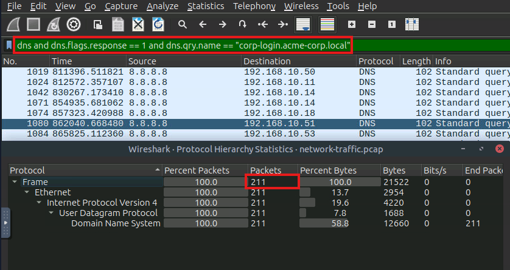
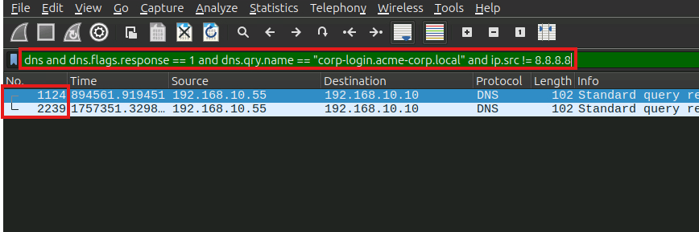
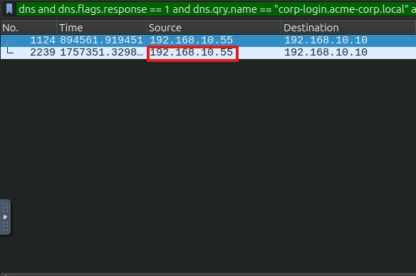
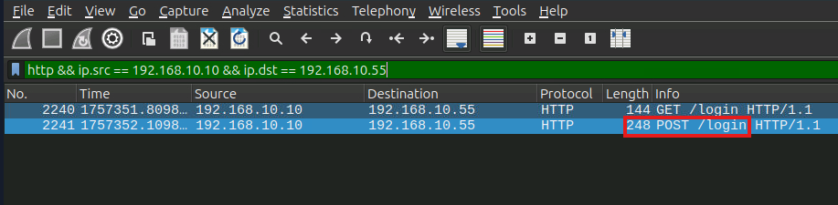
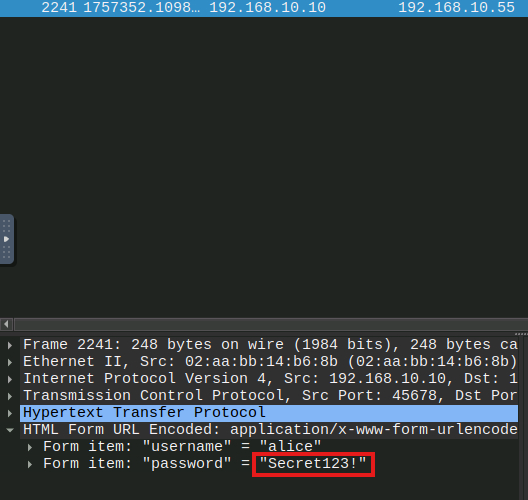

### Man-In-The-Middle Attacks

## Overview

Man-in-the-middle (MITM) attacks represent one of the most insidious threats in network security. In these attacks, attackers position themselves between legitimate communication endpoints to intercept, modify, or redirect traffic. From a blue team perspective, detecting these attacks requires a multi-layered approach combining network monitoring, certificate validation, and behavioral analysis. 
In this room, we'll learn the fundamentals of Man-in-the-Middle (MITM) attacks and how to spot the signs in network traffic.

### Objective

- Understand common MITM attack vectors and techniques
- Learn to identify indicators of compromise related to MITM attacks
- Master network monitoring tools for detecting suspicious traffic patterns
- Practice incident response procedures for MITM scenarios
- Cover three chained MITM techiques. ARP Spoofing, DNS Spoofing and SSL Stripping

## Tools Used
| Tool | Purpose |
|---|---|
| Wireshark | Deep packet analysis |

## Notes

1. Interception: The attacker inserts themselves into a communication stream, often by exploiting weaknesses in network protocols or by using techniques like ARP, DNS, or IP spoofing.
2. Manipulation/Decryption: The attacker tries to access or modify the communication, decrypting encoded data or injecting harmful content, such as altered website responses or fake login forms.
3. Packet sniffing: Capturing unencrypted data packets exchanged over a network, often on open Wi-Fi.
4. Session hijacking: Stealing and using session tokens to impersonate users.
5. SSL stripping: Downgrading HTTPS connections to insecure HTTP to steal or alter data transferred.
6. DNS spoofing: Redirecting legitimate website traffic to fraudulent domains by manipulating DNS responses.
7. IP spoofing: Crafting malicious IP packets that appear to come from trusted systems.
8. Rogue Wi-Fi access point: Creating fake networks to intercept user traffic.

### ARP Spoofing

### IoCs

1. Duplicate MAC-to-IP Mappings: Multiple MAC addresses claiming the same IP address. Indicates impersonation.
2. Unsolicited ARP Replies: High number of ARP replies without matching requests ("gratuitous ARP").
3. Abnormal ARP Traffic Volume: A Large number of ARP packets in short intervals.
4. Unusual Traffic Routing: Traffic rerouted through the attacker’s MAC.
5. Gateway Redirection Patterns: Multiple destination MACs for the same gateway IP.
6. ARP Probe / Reply Loops: Many ARP requests with Who has 192.168.1.x? Tell 192.168.1.y patterns.

### Task 1 — How many ARP packets from the gateway MAC Address were observed?

- Filtered ARP and the initial source mac address in the packet capture. 

### Task 2 — What MAC address was used by the attacker to impersonate the gateway?

- Search arp.opcode == 2 for the gateway address, identify "alternatives" mac address for the gateway.

### Task 3 — How many Gratuitous ARP replies were observed for 192.168.10.1?

- Filter for arp.isgratuitous and gateway address, only 2 packets were found.

### Task 4 — How many unique MAC addresses claimed the same IP (192.168.10.1)?

- Search arp.opcode == 2 for the gateway address, count total unique mac address for the gateway.

### Task 5 — How many ARP spoofing packets were observed in total from the attacker?

- Filtered for arp.opcode == 2, gateway ip address and the mac address of the attacker. Total 14 counts of packet

### DNS Spoofing

### IoCs

1. Multiple DNS responses for the same query: A legitimate resolver and a forged responder reply to the same query. This is the single most reliable indicator.
2. DNS response from an unexpected source: A DNS reply arrives from an IP address that does not match any configured resolver (like 8.8.8.8 or your DNS server).
3. Suspiciously short TTL (Time-To-Live) values: Attackers use very low TTLs (1 - 30s) to keep poisoned entries short-lived and reassert control.
4. Unsolicited DNS responses: A DNS reply appears without a corresponding DNS request from the victim.

### Task 1 — How many DNS responses were observed for the domain corp-login.acme-corp.local?

- Filtered for DNS response request with query that contains the URL.

### Task 2 — How many DNS requests were observed from the IPs other than 8.8.8.8?

- Filtered DNS requests with source IP does not equal to 8.8.8.8 and still contained the query from previous task.

### Task 3 — What IP did the attacker’s forged DNS response return for the domain?

- Identified the source IP that is not 8.8.8.8

### SSL Stripping

### IoCs

1. Initial Request vs. Response: The user's initial request may be for HTTPS (port 443), but the subsequent packets immediately shift to unencrypted HTTP (port 80) for the same domain.
2. Redirects/Link Rewriting: Monitoring for redirects (HTTP Status Codes 301, 302) that persistently direct an HTTPS request to an HTTP resource.
3. Certificate Errors: Although the attacker usually tries to hide this, the initial TLS/SSL Handshake may fail or display a self-signed certificate if the attacker uses a more direct proxying technique.

### Task 1 — How many POST requests were observed for our domain corp-login.acme-corp.local?

- Due to SSL stripping affectively change the protocol used after compromise, filter for HTTP with the respective attacker domain from previous task.

### Task 2 — What's the password of the victim found in the plaintext after successful ssl stripping attack. 

- Identify the exposed credentials.

## Summary 

1.1 ARP Spoofing (cache poisoning):
      1.1.1 ARP spoof begins, attacker sends unsolicited ARP is-at claiming gateway IP.
2.1 DNS Spoofing (forged DNS responses):
      2.1.1 Victim DNS query for corp-login.acme-corp.local.
      2.1.2 Forged DNS response from attacker, answers domain → 192.168.10.55.
3.1 SSL Stripping (TLS downgrade / credential capture):
      3.1.1 The Victim initiates connection to resolved IP, HTTP to attacker (SSL stripping effect).
      3.1.2 Credential POST observed (cleartext).
      
---

## Key Takeaways

- **Takeaway 1** — 

### Practical Application

---
