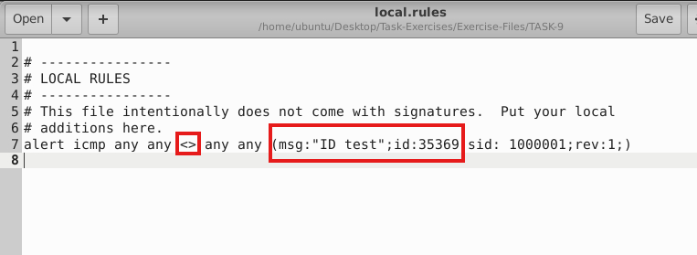
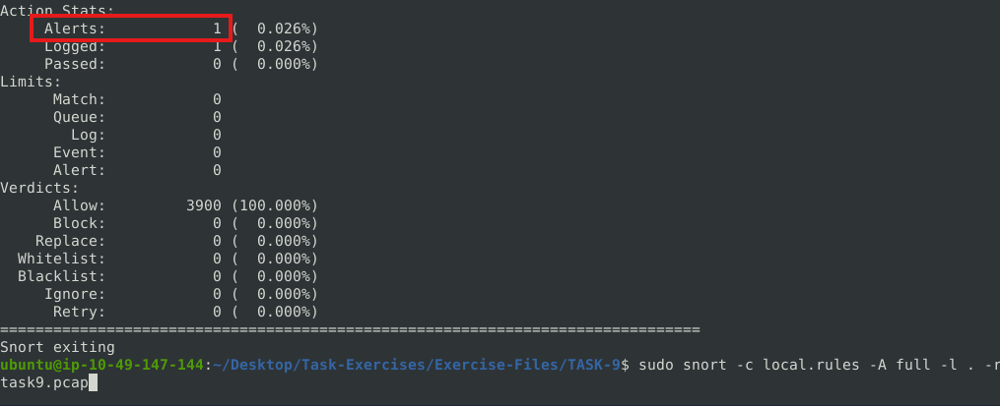
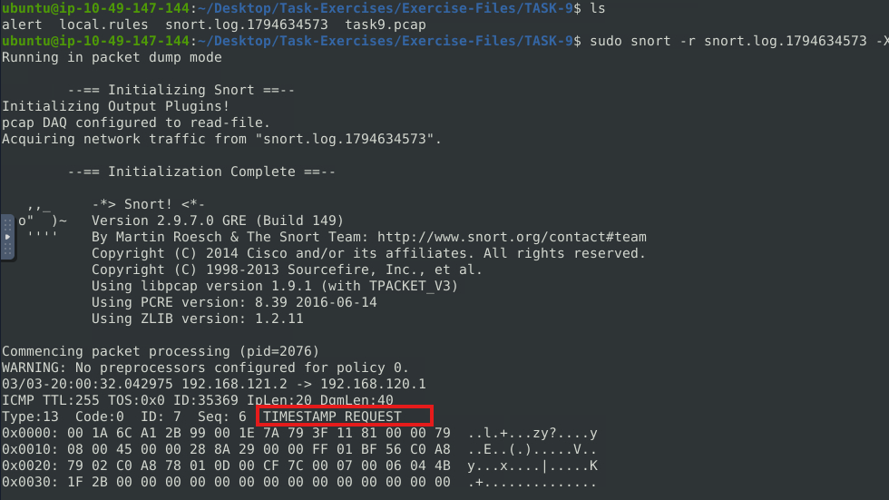
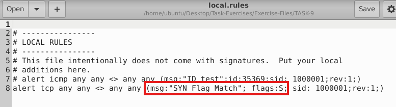
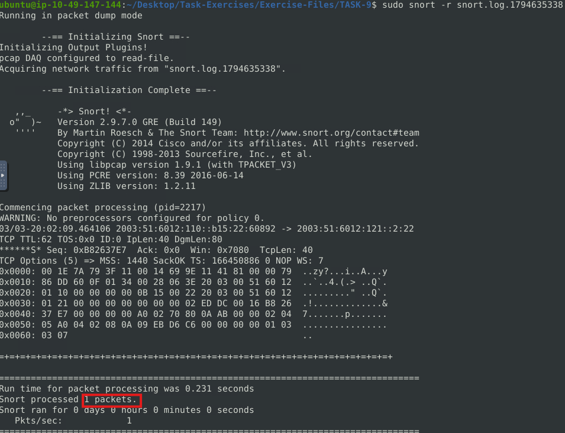
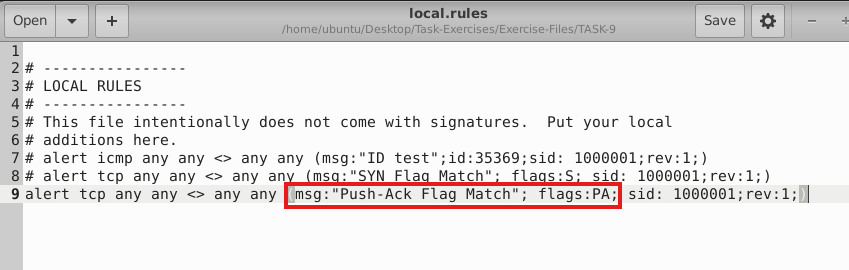
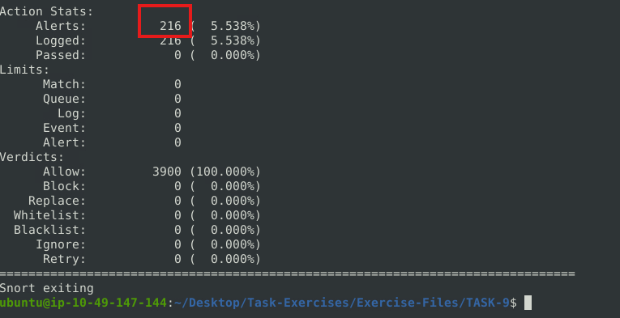
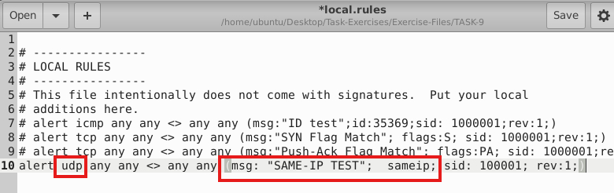
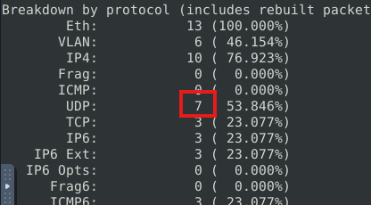

### Snort Rules

## Overview

Understanding the Snort rule format is essential for any blue and purple teamer.  The primary structure of the Snort rule is shown below

eg. alert icmp any any <> any any ( msg: "ICMP Packet found"; reference:CVE-XXXX; sid:1000001; rev:1; )

### Objective

- Understanding Snort rule structure.
- Able to create/tune rules for Snort

## Tools Used
| Tool | Purpose |
|---|---|
| Snort | Intrusion Detection analysis and alert tuning |

## Notes

1. Action - alert(generate alert, log packet), log(log packet), drop(block,log packet), reject(block packet,log,terminate packet session)
2. Protocol - officially supports IP,TCP/IP,UDP,ICMP. Eg. To detect FTP, need to filter traffic by investigating TCP traffic on port 21.
3. IP Filtering - From single IP source - alert icmp 192.168.1.56 any
4. IP Filtering - From subnet - alert icmp 192.168.1.0/24 any
5. IP Filtering - From multiple subnets - alert icmp [192.168.1.0/24, 10.1.1.0/24] any
6. IP Filtering - From not from subnet - alert icmp !192.168.1.0/24 any
7. Port Filtering - To specific port - alert tcp any any <> any 21
8. Port Filtering - Not to specific port - alert tcp any any <> any !21
9. Port Filtering - To between specific port range - alert tcp any any <> any 1:1024
10. Port Filtering - Through specific ports - alert tcp any any <> any:1024 (seems redundant)
12. Port Filtering - To higher or equal to specific port - alert tcp any any <> any 1025:
13. Port Filtering - To multiple specific ports - alert tcp any any <> any [21,23]
14. Rule options - General, Payload, Non-Payload
15. General rule - Msg -  one-liner that summarises the event.
16. General rule - Sid - <100(Reserved rules), 100-999999(built-in), >=1000000(User created)
17. General rule - Reference - reference to explain the purpose of the rule or threat pattern. eg (Common Vulnerabilities and Exposures (CVE) ID or external data)
18. General rule - Rev - Analysts should keep their own rule history. The ' Rev' option is only an indicator of how many times the rule has undergone revisions.
19. Payload Detection - Content - matches specific payload data by ASCII, HEX, or both. more specific pattern match,more time it takes to investigate a packet. 
Eg. Look for "GET". ASCII mode (alert tcp any any <> any 80  (msg: "GET Request Found"; content:"GET"; sid: 100001; rev:1;))
Eg. HEX mode (alert tcp any any <> any 80  (msg: "GET Request Found"; content:"|47 45 54|"; sid: 100001; rev:1;))
20. Payload Detection - Nocase - Disabling case sensitivity. Used for enhancing the content searches. Eg. alert tcp any any <> any 80  (msg: "GET Request Found"; content:"GET"; nocase; sid: 100001; rev:1;)
21. Payload Detection - Fast_pattern - The "fast_pattern" option helps you select the initial packet match with a specific value for further investigation.always works case-insensitively and can be used once per rule. Note that this option is required when using multiple "content" options./
Eg. alert tcp any any <> any 80  (msg: "GET Request Found"; content:"GET"; fast_pattern; content:"www";  sid:100001; rev:1;)
22. Non-Payload Detection - ID - Filtering the IP ID field. Eg. alert tcp any any <> any any (msg: "ID TEST"; id:123456; sid: 100001; rev:1;)
23. Non-Payload Detection - Flags - F(FIN), S(SYN), R(RST), P(PSH), A(ACK), U(URG) Eg. alert tcp any any <> any any (msg: "FLAG TEST"; flags:S;  sid: 100001; rev:1;)
24. Non-Payload Detection - Dsize - Filtering the packet payload size. (dsize:min<>max;, dsize:>100, dsize:<100) Eg. alert ip any any <> any any (msg: "SEQ TEST"; dsize:100<>300;  sid: 100001; rev:1;)
25. Non-Payload Detection - Sameip - Filtering the source and destination IP addresses for duplication. Eg. alert ip any any <> any any (msg: "SAME-IP TEST";  sameip; sid: 100001; rev:1;)

### Notes/IoCs

1. 

### Task 1 Use "task9.pcap". Write a rule to filter IP ID "35369" and run it against the given pcap file. What is the request name of the detected packet? You may use this command: "snort -c local.rules -A full -l . -r task9.pcap"

- Assign the TASK-9 folder as log directory, edit local rules to filter IP ID:35369, run snort for task-9pcap against local rules. Read the alert file and identified the request type.
- Assigning the target directory (sudo snort -l.)
- Edit local rules (sudo gedit local rules)
- IP is a header so rules are modified in the msg section and direction change to bidirectional.
- Run the pcap file against local rules. (sudo snort -c local.rules -A full -l . -r task9.pcap)
- Read the alert file (sudo snort -r snort.log.1794634573 -X)

### Task 2 — Clear the previous alert file and comment out the old rules. Create a rule to filter packets with Syn flag and run it against the given pcap file. What is the number of detected packets?

- Repeat the previous steps with the new rule for Syn flag

### Task 3 — Clear the previous alert file and comment out the old rules. Write a rule to filter packets with Push-Ack flags and run it against the given pcap file. What is the number of detected packets?

- - Repeat the previous steps with the new rule for Push-Ack flag

### Task 4 — Clear the previous alert file and comment out the old rules. Create a rule to filter UDP packets with the same source and destination IP and run it against the given pcap file. What is the number of packets that show the same source and destination address?

- Total is 13. Summary provides the total packets of the UDP with the same ip. However, there are traffic we can ignore to improve the filtering and get precisely 7 packets. Exclude unassigned IP address, broadcast (255.255...) and multicast (224.0.0.0/4)

---

## Key Takeaways

- **Takeaway 1** — 

### Practical Application

---
