### Snort

## Overview

Learn how to use Snort to detect real-time threats, analyse recorded traffic files and identify anomalies.

### Objective

- Overview of IDS / IPS
- Snort Overview
- Writing IDS rules
- Detecting Intrusion with Snort

## Tools Used
| Tool | Purpose |
|---|---|
| Snort | Intrusion Detection analysis and alert tuning |

## Notes

1. snort directory - /etc/snort or /usr/local/etc/snort
2. running snort for detection - snort -q -l /var/log/snort -r Task.pcap -A alert_fast -c /etc/snort/snort.lua (Task is the target pcap)

### Fundamentdals

### Notes/IoCs

1. 

### Task 1 — What is the IP address of the machine that tried to connect to the subject machine using SSH?
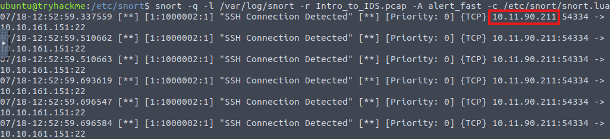

- use running snort for detection command to see the logs. Identified the IP based on data structure.

### Task 2 — What other rule message besides the SSH message is detected in the PCAP file?
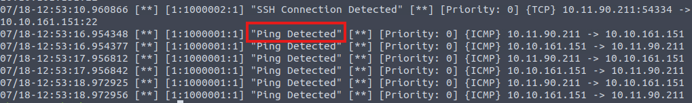

- rule message can be identified within the rule metadata section of the log. 

### Task 3 — What is the sid of the rule that detects SSH?
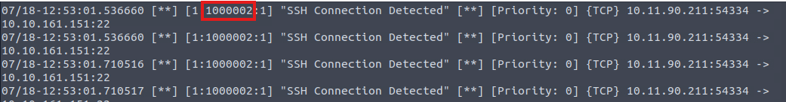

- sid can also be identified within the metadata section of the log.

### Introduction

### Notes/IoCs

1. Identifies (-c) and test config (-T) -  snort -c /etc/snort/snort.conf -T
2. Config file contains rules, plugins, detection mechanisms, default actions and output settings.
3. -V shows version and -q skips default banner and initial information dump.

### Sniffer Mode

### Notes/IoCs

1. Display the TCP/IP output in the console. -v
2. Display the packet data (payload). -d
3. Display the link-layer (TCP/IP/UDP/ICMP) headers. -e
4. Display the full packet details in HEX. -X
5. This parameter helps define a specific network interface to listen to or sniff. Once you have multiple interfaces, you can choose a specific interface to sniff.  -i
6. Use sudo snort (any of the combination above)

### Packet Logging

### Notes/IoCs

1. Logger mode, target log, and alert output directory. Default output folder is /var/log/snort. The default action is to dump as tcpdump format in /var/log/snort. -l
2. Log packets in ASCII format. - K ASCII
3. Reading option: Review the logged events in Snort. -r
4. Specify the number of packets to be processed or read. Snort will stop after reading the specified number of packets. -n
5. Elevation of Privileges -  sudo chown username file or sudo chown username -R directory. The "-R" parameter enables recursive processing of files and directories.
6. Example of reading and pre-filtering (sudo snort -r logname.log icmp, sudo snort -r logname.log tcp, sudo snort -r logname.log 'udp and port 53')

### Task 1 — What is the source port used to connect port 53?
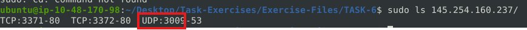

- use "sudo snort -dev -K ASCII -l." to assign target directory for logs. run traffic generator to generate log.

### Task 2 — Use snort.log.1640048004. Read the snort.log file with Snort; what is the IP ID of the 10th packet?
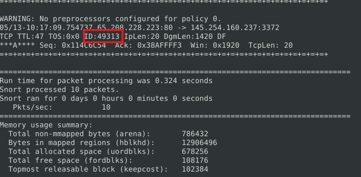

- use "sudo snort -r snort.log.1640048004 -n 10" to limit entries to 10. Identify the IPID using ID:

### Task 3 — Read the "snort.log.1640048004" file with Snort; what is the referer of the 4th packet?
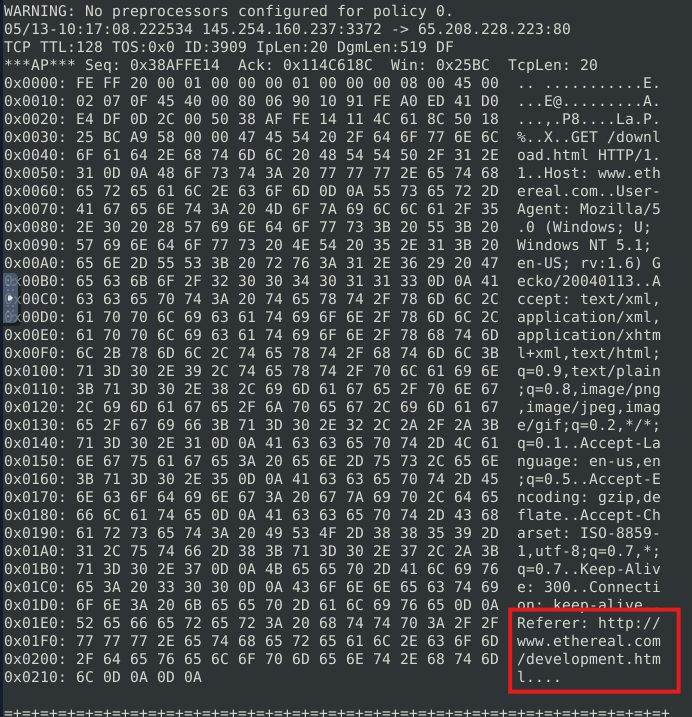

- use sudo "snort -r snort.log.1640048004 -n 4 -X" to limit packet to 4 and check the hex for the referrer details.

### Task 4 — Read the "snort.log.1640048004" file with Snort; what is the Ack number of the 8th packet?
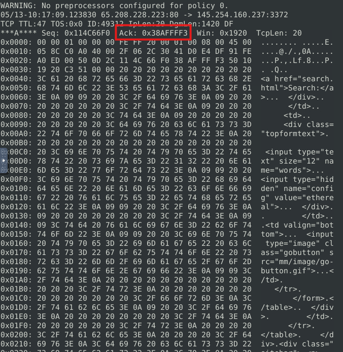

- use "sudo snort -r snort.log.1640048004 -n 8 -X" to find the 8th packet and identify the Ack number.

### Task 5 — Read the "snort.log.1640048004" file with Snort; what is the number of the "TCP port 80" packets?
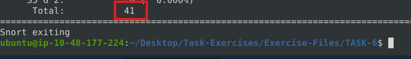

- use "sudo snort -r snort.log.1640048004 'tcp and port 80'" to apply filtering and summary for tcp port 80 packets.

### IDS/IPS

### Notes/IoCs

1. Defining the configuration file. -c
2. Testing the configuration file. -T
3. Disable logging. -N
4. Background mode. -D
5. Alert modes. -A (Full, Fast mode(alert message, timestamp, source and destination ip addr), Console(fast style alerts on console), cmg(basic header details with payload and hex), None)
6. Config file sudo snort -c /etc/snort/snort.conf
7. Running without config file sudo snort -c /etc/snort/rules/local.rules -A console
8. Running IPS mode sudo snort -c /etc/snort/snort.conf -q -Q --daq afpacket -i eth0:eth1 -A console

### Task 1 — What is the number of the detected HTTP GET methods?
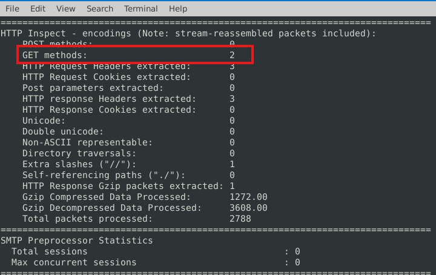

-

### PCAP Investigation

### Notes/IoCs

1. Read a single pcap. - -r / --pcap-single=
2. Read pcaps provided in command (space separated). - --pcap-list=""
3. Show pcap name on console during processing. - --pcap-show

### Task 1 — What is the number of the generated alerts?
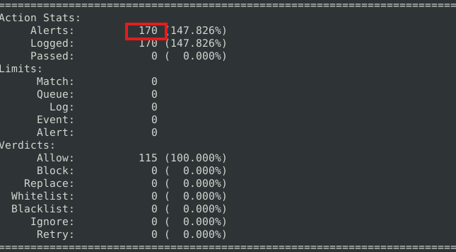

- use "sudo snort -c /etc/snort/snort.conf -A full -l . -r mx-1.pcap" to generate summary. 

### Task 2 — Keep reading the output. How many TCP Segments are Queued?
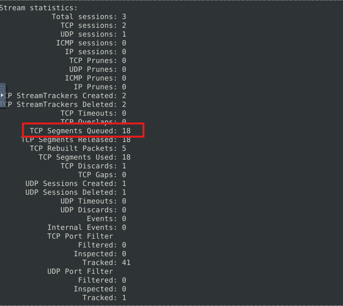

- navigate to breakdown by protocol and identify TCP.

### Task 3 — Keep reading the output.How many "HTTP response headers" were extracted?
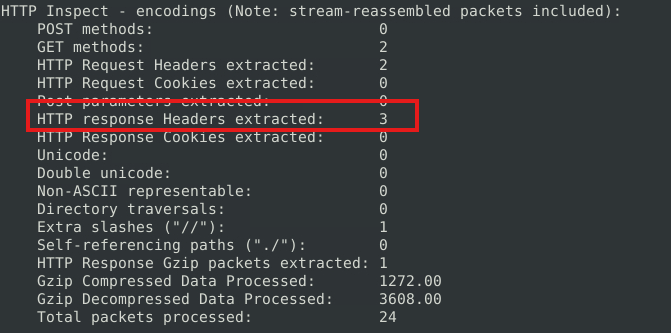

- Identify HTTP response headers.

### Task 4 — Investigate the mx-1.pcap file with the second configuration file. sudo snort -c /etc/snort/snortv2.conf -A full -l . -r mx-1.pcapWhat is the number of the generated alerts?
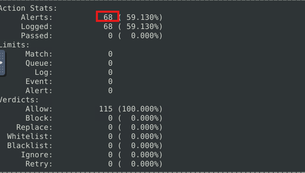

- Identify the number of alerts for mx1 against second config.

### Task 5 — Investigate the mx-2.pcap file with the default configuration file. What is the number of the generated alerts?
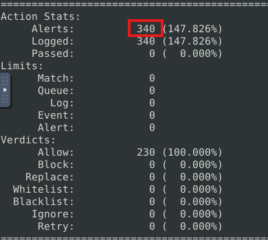

- USe "sudo snort -c /etc/snort/snort.conf -A full -l . -r mx-2.pcap" and identify the total alerts against default config.

### Task 6 — Keep reading the output. What is the number of the detected TCP packets?
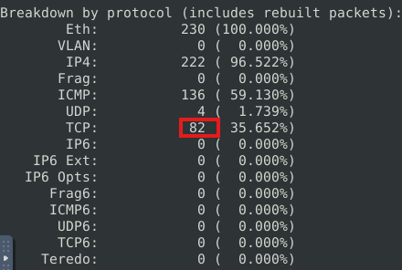

- Identify the TCP packets.

### Task 7 — Investigate the mx-2.pcap and mx-3.pcap files with the default configuration file. sudo snort -c /etc/snort/snort.conf -A full -l . --pcap-list="mx-2.pcap mx-3.pcap". What is the number of the generated alerts?
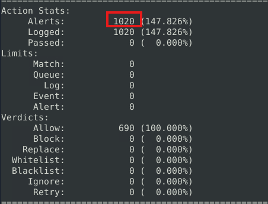

- Combine the two pcap file under a single summary and identify the total alerts generated. 

---

## Key Takeaways

- **Takeaway 1** — 

### Practical Application

---
