## Wireshark: Packet Operations

## Overview

Cover the fundamentals of packet analysis with Wireshark and investigate the event of interest at the packet-level.

### Objective

Investigate network traffic captures
View statistics including summary and protocol details
Uncover and apply packet filtering principles
Apply protocol filters
Apply advanced filtering

## Tools Used

| Tool | Purpose |
|---|---|
| Wireshark | Used for packet analysis |

---

## Tasks

### Task 1 — What is the IP address of the hostname starts with "bbc"?
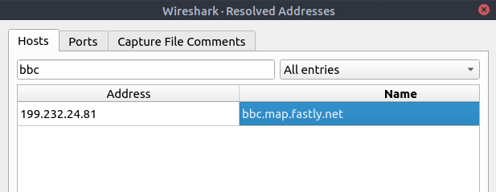

### Task 2 — What is the number of IPv4 conversations?
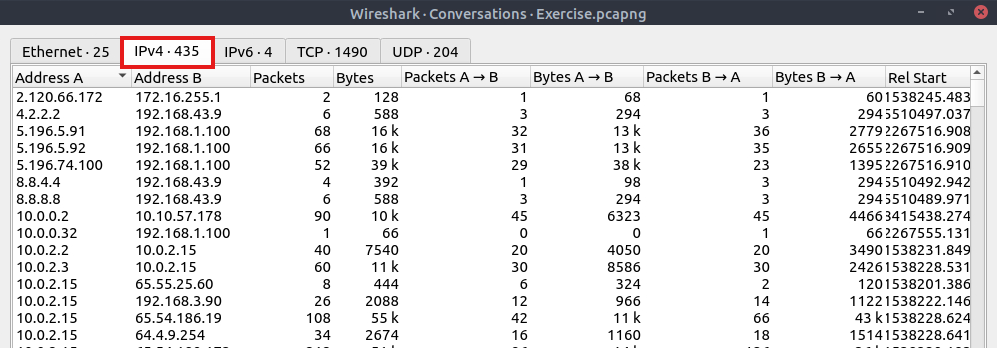

### Task 3 — How many bytes (k) were transferred from the "Micro-St" MAC address?

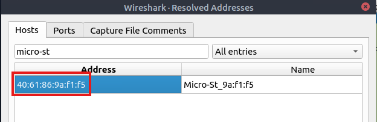
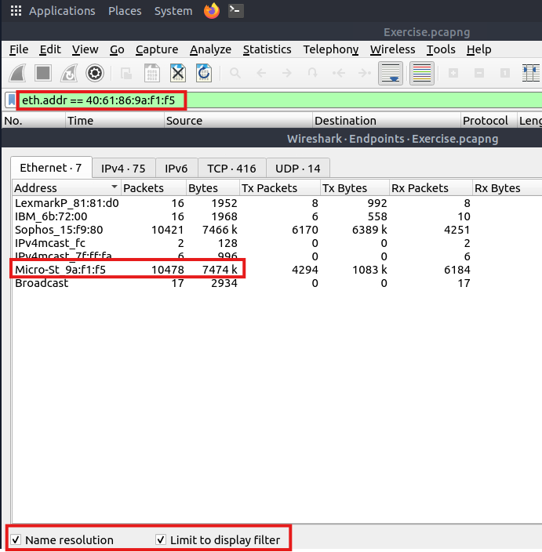

### Task 4 — What is the number of IP addresses linked with "Kansas City"?
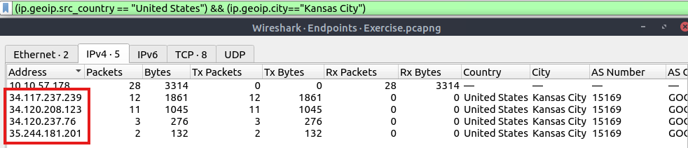

### Task 5 — Which IP address is linked with "Blicnet" AS Organisation?
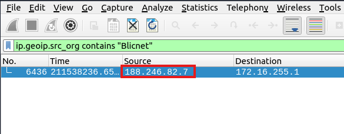

---

## Key Takeaways

- **Takeaway 1** — Resolved Addresses (identify IP addresses and DNS names available in the capture file.)
- **Takeaway 2** — Protocol Hierarchy (breaks down all available protocols from the capture file and helps analysts view the protocols in a tree view based on packet counters and percentages.)
- **Takeaway 3** — Conversations (provides the list of the conversations in five base formats; ethernet, IPv4, IPv6, TCP and UDP.)
- **Takeaway 4** — Endpoints (provides unique information for a single information field such as Ethernet, IPv4, IPv6, TCP and UDP ).

---

## Statistics Protocol Details

### Objective
- Extends learning statistic feature to IPv4, IPv6, DNS and HTTP
- The statistics menu has two options for narrowing the statistics on packets containing a specific IP version. Thus, analysts can identify and list all events linked to specific IP versions in a single window and use it for the event of interest.

---
## Tasks

### Task 1 — What is the most used IPv4 destination address?
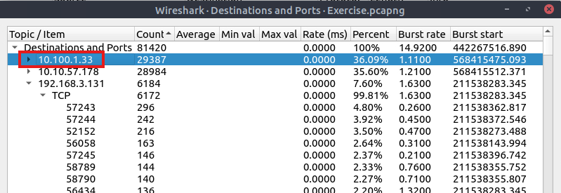

### Task 2 — What is the max service request-response time of the DNS packets?
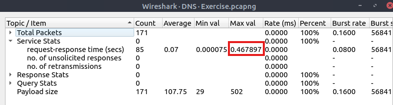

### Task 3 — What is the number of HTTP Requests accomplished by "rad[.]msn[.]com?
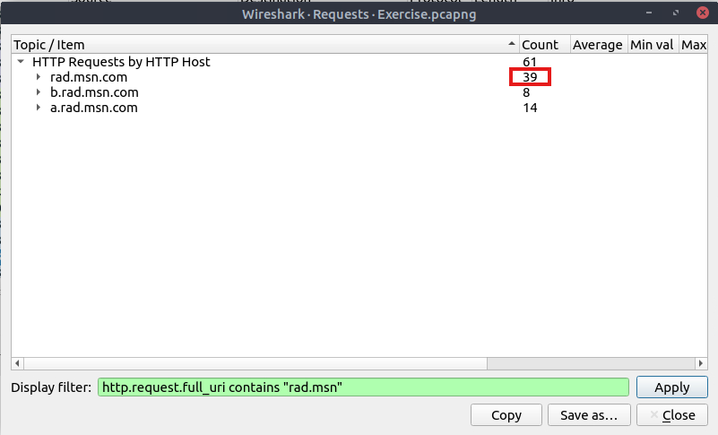

---

## Key Takeaways

- **Takeaway 1** — Specific statistics feature for IPs, DNS and HTTP provides detail insights on the data capture summarized and organized to analysis. It is one of many useful tool in analyst's toolbox to investigate and identify anomalies.

---

## Wireshark Protocol Filters

## Overview

Wireshark supports 3000 protocols and allows packet-level investigation by filtering the protocol fields. This task shows the creation and usage of filters against different protocol fields.

### Objective

- Utilize the protocol filters to help analysts filter the traffic according to the IP level information from the packets (Network layer of the OSI model).
- These filters filter network-level information like IP addresses, version, time to live, type of service, flags, and checksum values.
---

### Useful and Commonly Used Filters

### Filters

1. ip — show all IP packets.
2. ip.addr — show packets for a specific IP
3. ip.src — show packets from a specific IP
4. ip.dst — show packets to a specific IP
5. tcp.port/udp.port — show packets for a specific TCP/UDP port
6. tcp.srcport/udp.srcport — show packets from a specific TCP/UDP port
7. tcp.dstport/udp.dstport — show packets to a specific TCP/UDP port
8. http — show all HTTP packets
9. http.response.code — show all packets with a specific response code (200 for successful)
10. http.request.method — show all packets with a specific request method (GET, POST)
11. dns — show all DNS packets
12. dns.flags.response — show packets for a specific DNS response (0 for request, 1 for response)
13. dns.qry.type — show packets for a specific DNS type (eg. 1 for "A")

---

## Tasks

### Task 1 — What is the number of IP packets?
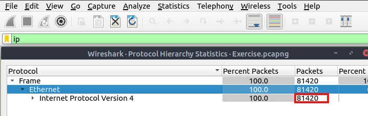

### Task 2 — What is the number of packets with a "TTL value less than 10"?
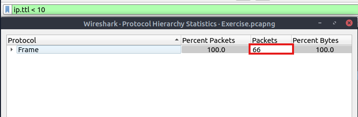

### Task 3 — What is the number of packets which uses "TCP port 4444"?
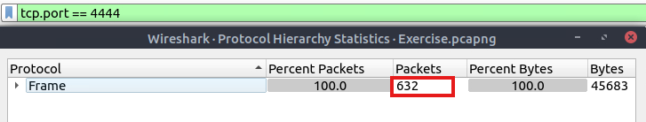

### Task 4 — What is the number of "HTTP GET" requests sent to port "80"?
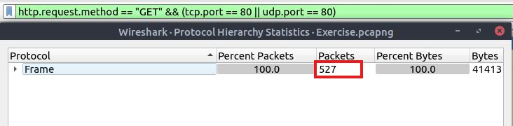

### Task 5 — What is the number of type A DNS Queries?
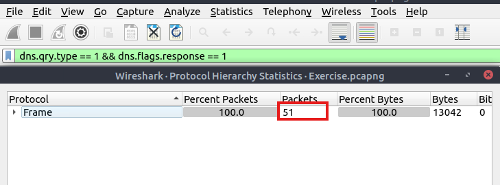

- Therefore, filters like dns.flags.response == 1 && dns.qry.type == 1 are used because the requested data points (Type A records) are delivered and parsed within the response packets.

---

## Key Takeaways

- **Takeaway 1** — 

### Practical Application

---

## Wireshark:Network Analysis

## Overview

Investigate and correlate the packet-level information to see the big picture in the network traffic, like detecting anomalies and malicious activities. For a security analyst, it is vital to stop and understand pieces of information spread in packets by applying the analyst's knowledge and tool functionality. This room will cover investigating packet-level details by synthesizing the analyst knowledge and Wireshark functionality for detecting anomalies and odd situations for a given case.

## Tools Used

| Tool | Purpose |
|---|---|
| Wireshark | Conduct network investigation, correlation and analysis |

---

## NMAP Scans

## Notes

1. Only SYN flag. (tcp.flags == 2)
2. SYN flag is set. (tcp.flags.syn == 1)
3. Only ACK flag. (tcp.flags == 16)
4. ACK flag is set. (tcp.flags.ack == 1)
5. Only SYN, ACK flags. (tcp.flags == 18)
6. SYN and ACK are set. (tcp.flags.syn == 1) and (tcp.flags.ack == 1)
7. Only RST flag. (tcp.flags == 4)
8. RST flag is set. (tcp.flags.reset == 1)
9. Only RST, ACK flags. (tcp.flags == 20)
10. RST and ACK are set (tcp.flags.reset == 1) and (tcp.flags.ack == 1)
11. Only FIN flag. (tcp.flags == 1)
12. FIN flag is set. (tcp.flags.fin == 1)

## Additional Notes

1. TCP Connect Scan ( Open TCP port, SYN inbound > SYN-ACK outbound > ACK inbound > RST-ACK inbound )
2. TCP Closed Port ( Close TCP port SYN inbound > RST-ACK outbound )
3. nmap -sT command , byte > 1024 , RST-ACK required, non-privileged user
4. TCP SYN Scan ( Open TCP Port, SYN inbound > SYN-ACK outbound > RST inbound )
5. TCP SYN SCan ( Close TCP Port, SYN inbound > RST-ACK outbound )
6. nmap -sS command , byte <= 1024 , no RST-ACK required , privileged user
7. UDP Scan (Open UDP port, UDP packet inbound)
8. UDP Scan (Close UDP Port, UDP packet inbound, ICMP Type 3 Code 3 message ( Unreachable, port unreacheable ) 

### Task 1 — What is the total number of the "TCP Connect" scans?
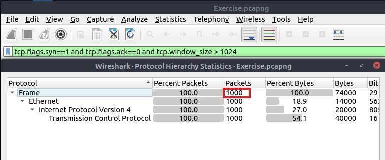

- used filter tcp.flags.syn==1 and tcp.flags.ack==0 and tcp.window_size > 1024 to identify packets that are syn = 1, ack = 0 (because is not relevant in this context, we are filtering TCP connect scans whether successful or not) and byte size must be > 1024. 

### Task 2 — Which scan type is used to scan the TCP port 80?
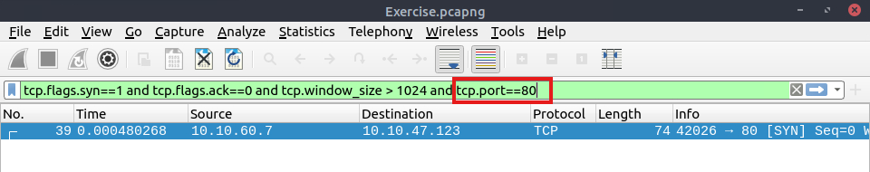
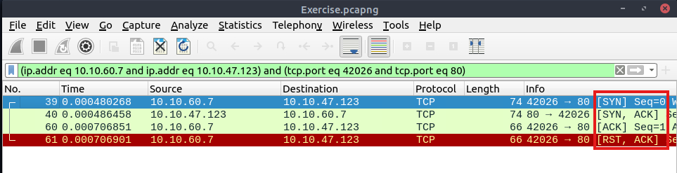

- filter TCP scan for port 80, and then filter the result by conversation. This leads to identifying what kind of scan type it is. In this case it is TCP Connect because TCP Connect Scan ( Open TCP port, SYN inbound > SYN-ACK outbound > ACK inbound > RST-ACK inbound )

### Task 3 — How many "UDP close port" messages are there?
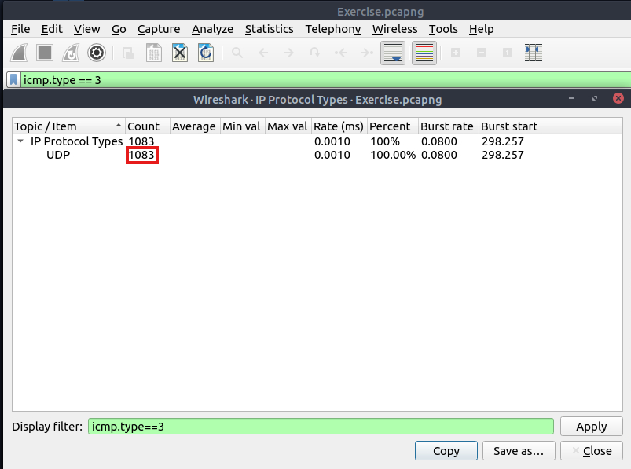

### Task 4 — Which UDP port in the 55-70 port range is open?
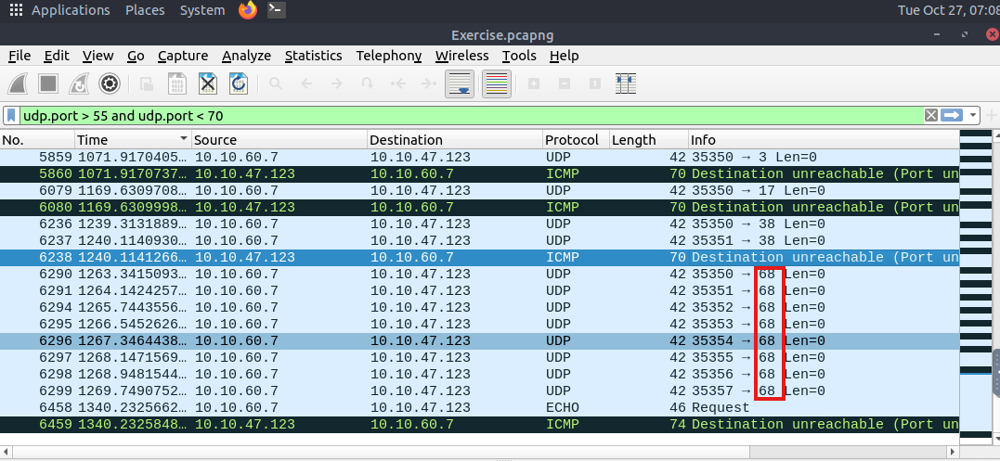

---

## ARP Poisoning and MITM (Layer 2)

## Notes

1. Opcode 1: ARP requests. (arp.opcode == 1)
2. Opcode 2: ARP responses. (arp.opcode == 2)
3. Arp scanning (arp.dst.hw_mac==00:00:00:00:00:00)
4. Possible ARP poisoning detection (arp.duplicate-address-detected or arp.duplicate-address-frame)
5. Possible ARP flooding from detection (((arp) && (arp.opcode == 1)) && (arp.src.hw_mac == target-mac-address))

### Task 1 — What is the number of ARP requests crafted by the attacker?
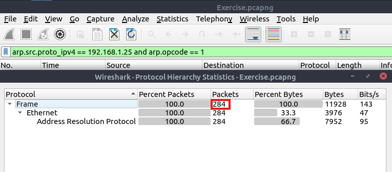

### Task 2 — What is the number of HTTP packets received by the attacker?
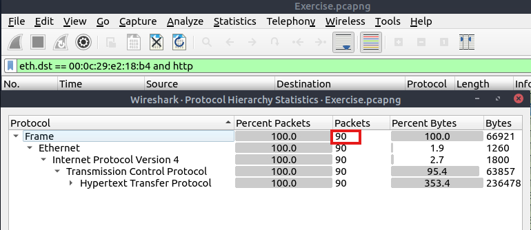

### Task 3 — What is the number of sniffed username&password entries?
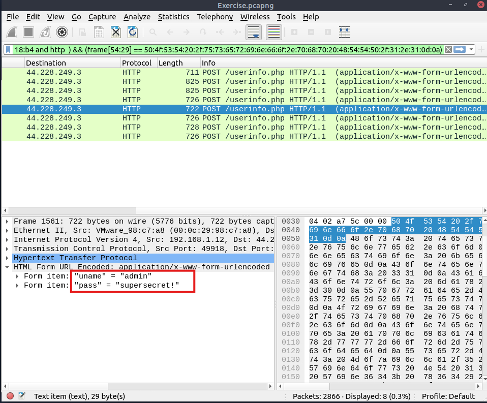

### Task 4 — What is the password of the "Client986"?
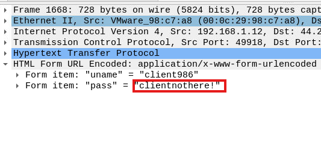

### Task 5 — What is the comment provided by the "Client354"?
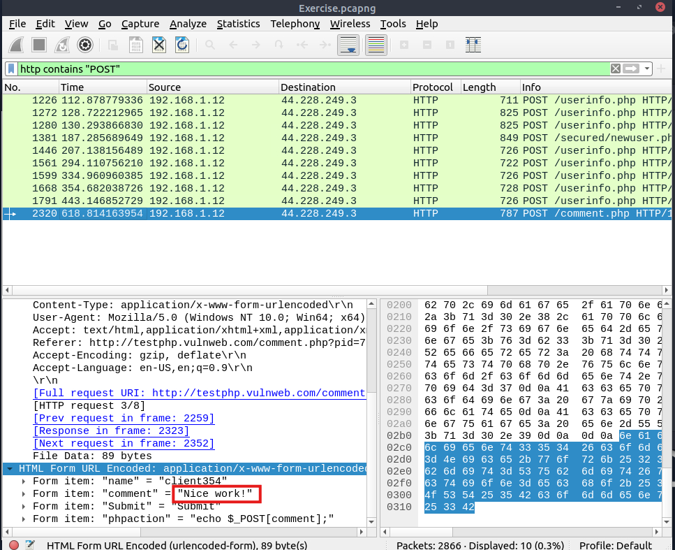

---

## DHCP, NetBios and Kerberos

## Notes

1. "DHCP Request" packets contain the hostname information (dhcp.option.dhcp == 3)
2. DHCP Requests options (12 Hostname, 50 Requested IP address, 51 Requested IP lease time, 61 Client's MAC address)
3. "DHCP ACK"packets represent the accepted requests (dhcp.option.dhcp == 5)
4. DHCP ACK options (15 Domain Name, 51 Assigned IP lease time)
5. "DHCP NAK"packets represent denied requests (dhcp.option.dhcp == 6)
6.  DHCP NAK option (56 Message (rejection details))
7.  NBNS, query details  could contain "name, Time to live (TTL) and IP address details" (nbns.name contains "keyword")
8.  Kerberos User account search (kerberos.CNameString and !(kerberos.CNameString contains "$" ))
9.  Kerberos protocol version (kerberos.pvno == 5)
10. Kerberos realm:Domain name for the generated ticket (kerberos.realm contains ".org")
11. Kerberos sname:Service and domain name for the generated ticket. (kerberos.SNameString == "krbtg")
12. Kerberos addresses:Client IP address and NetBIOS name. ( the "addresses" information is only available in request packets.)

### Task 1 — What is the MAC address of the host "Galaxy A30"?
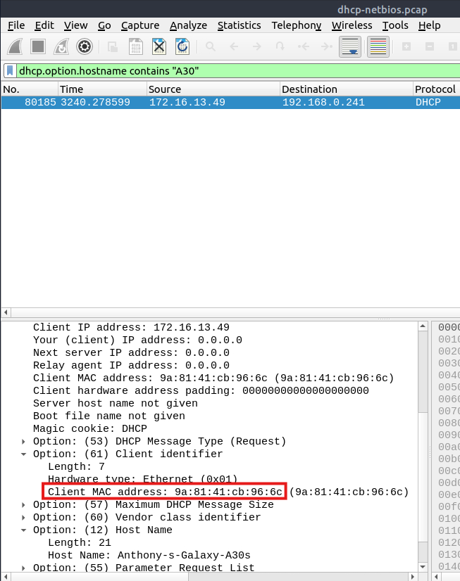

### Task 2 — How many NetBIOS registration requests does the "LIVALJM" workstation have?
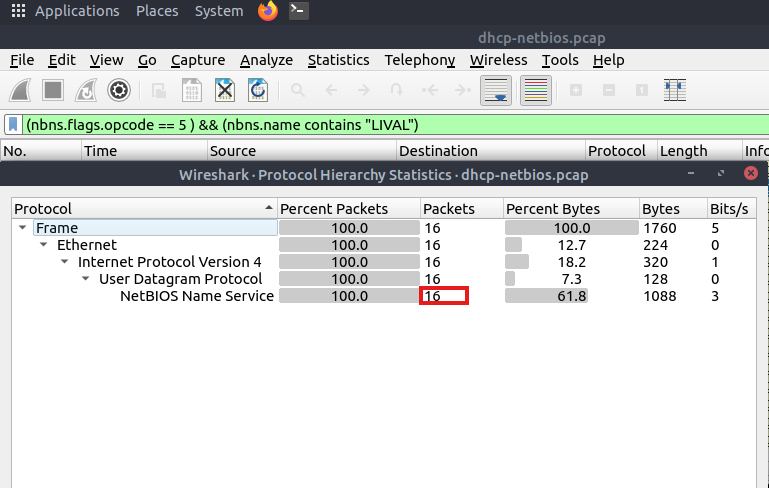

### Task 3 — Which host requested the IP address "172.16.13.85"?
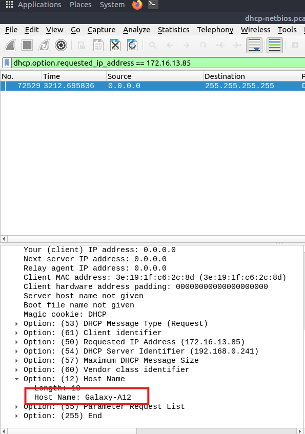

### Task 4 — What is the IP address of the user "u5"? (Enter the address in defanged format.)
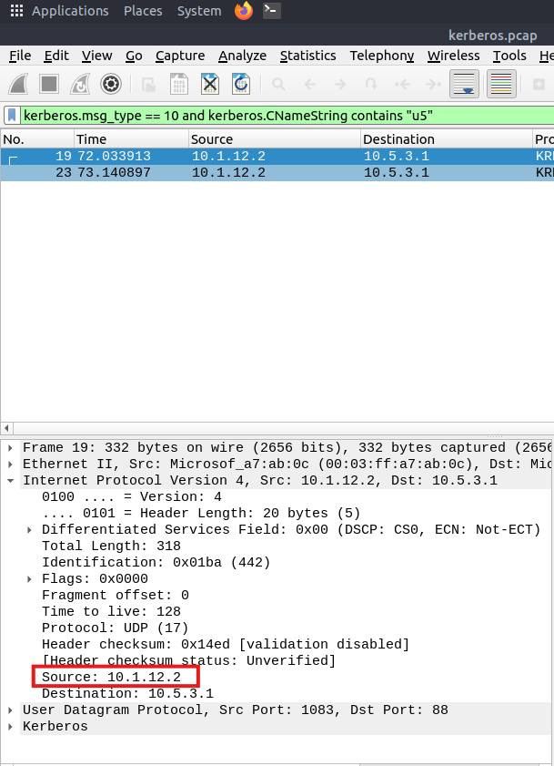

### Task 5 — What is the hostname of the available host in the Kerberos packets?
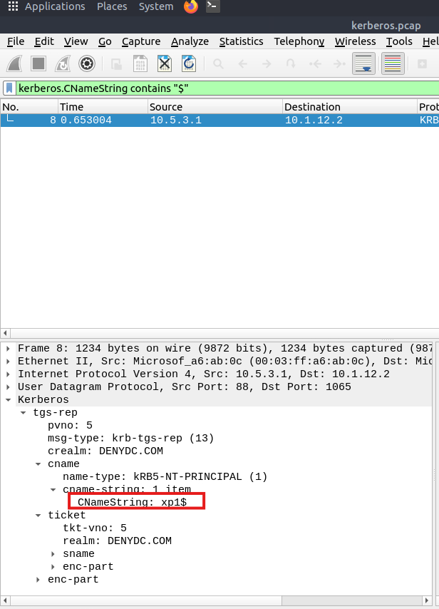

---

## DNS and ICMP

## Notes

1."ICMP" options for grabbing the low-hanging fruits, Packet length, ICMP destination addresses, Encapsulated protocol signs in ICMP payload (data.len > 64 and icmp)
2. Worth checking TCP, HTTP or SSH data within ICMP payload.
3."DNS" options for grabbing the low-hanging fruits, Query length, Anomalous and non-regular names in DNS addresses, Long DNS addresses with encoded subdomain addresses (dns contains "dnscat",dns.qry.name.len > 15 and !mdns)

### Task 1 — Which protocol is used in ICMP tunnelling?
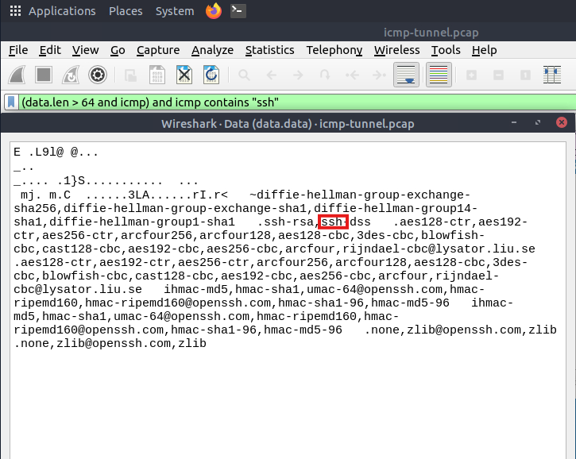

- Worth querying for TCP, HTTP or SSH within the payload as low-hanging fruit. Used this method to convert payload into hex to read the payload and identify the protocol used.

### Task 2 — What is the suspicious main domain address that receives anomalous DNS queries? (Enter the address in defanged format.)
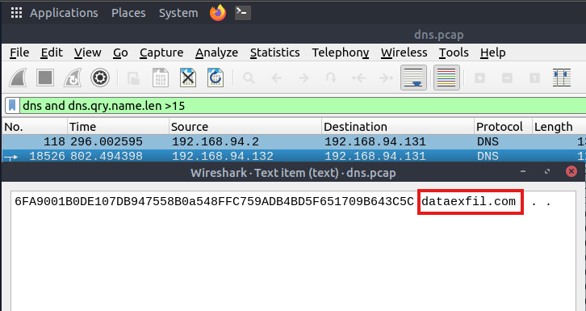

- Filter for query name length more than 15 characters, decode the payload into hex and identify the domain address that is receiving anomalous queries.

---

## FTP

### Task 1 — 

### Task 2 — 

### Task 3 — 

### Task 4 — 

---

## HTTPS

### Task 1 — 

### Task 2 — 

### Task 3 — 

### Task 4 — 

---
## Key Takeaways

- **Takeaway 1** — 

### Practical Application

---
