## The Greenholt Phish

## Overview

A sales executive at Greenholt PLC has reported a suspicious email received from a known customer. The message raised several red flags: a generic greeting, an unexpected request for a money transfer, and an unsolicited attachment. According to the employee, this behavior does not align with the customer’s usual communication style. Concerned that the email may be malicious, the message has been escalated to the SOC (Security Operations Center) for further investigation. Your goal is to analyze the provided email sample and determine whether it is legitimate or part of a phishing attempt.

### Objective

- Analyze the provided email to identify and extract key artifacts
- Investigate the message source to determine its origin and authenticity
- Use analysis tools to assess the potential maliciousness of the email

## Tools Used

| Tool | Purpose |
|---|---|
| VirusTotal | Used for |
| SPF Checker | Used for |
| DMARC checker | Used for |
| VirusTotal | Used for |

---

## Tasks

### Task 1 — What is the Transfer Reference Number listed in the email's Subject line?
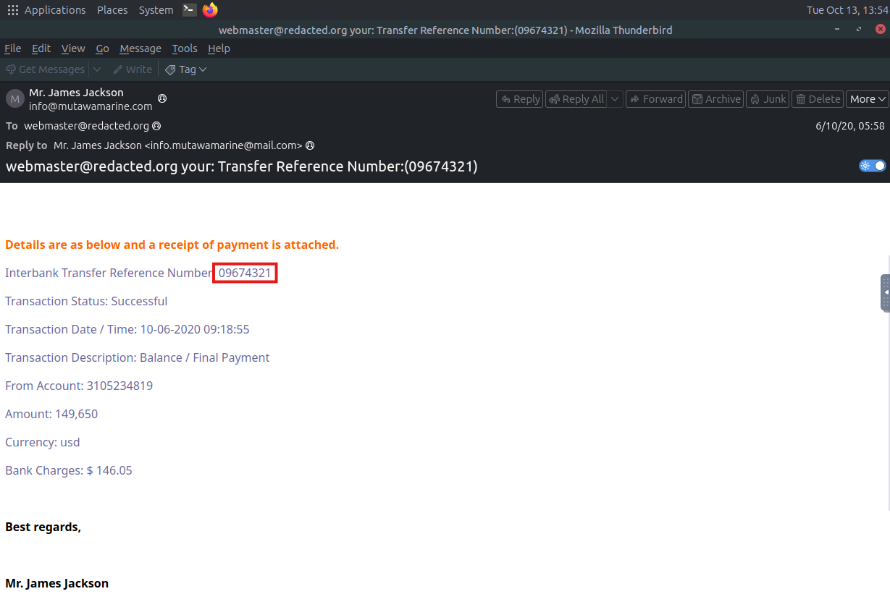

- Identified the Transfer Reference Number.

### Task 2 — What is the display name of the sender?
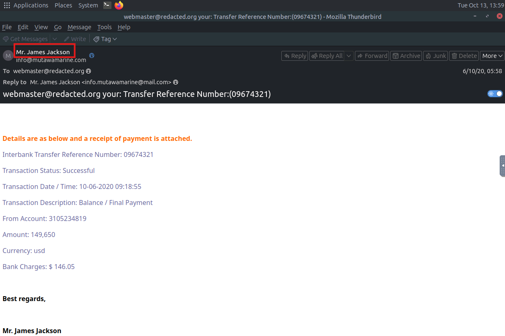

- Identified the Sender's display name.

### Task 3 — Continue investigating the email headers.
What is the sender's email address?
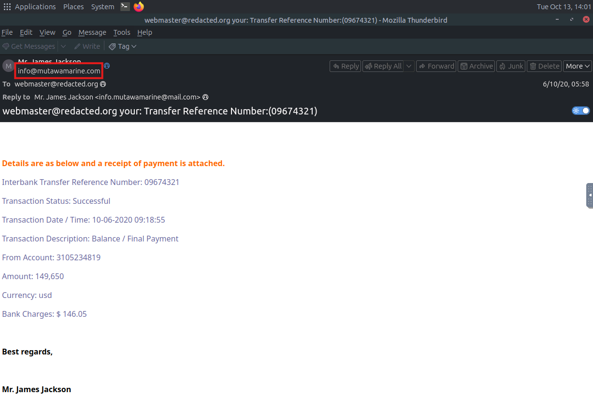

- Identified the Sender's email address.

### Task 4 — What email address will receive a reply to this email?

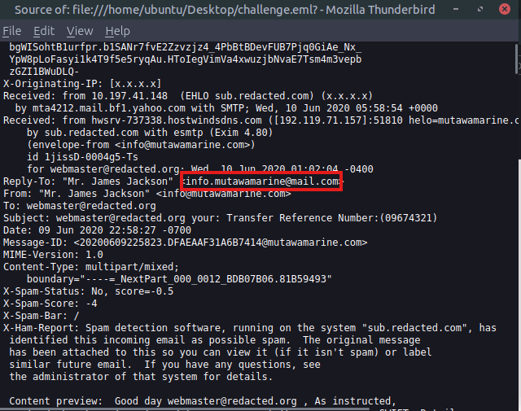

- Utilize View > Message Source and locate the Reply-To field to identify the email address.

### Task 5 — Begin analyzing the message source.
What is the originating IP address of this email?

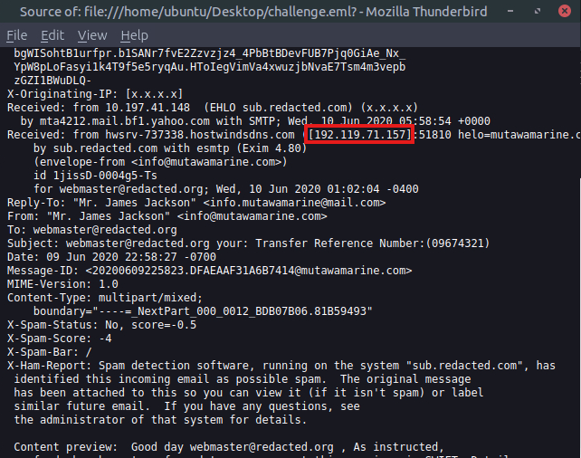

- Identified the originating IP address within message source. Double confirmed with Contact Analysis section of the message source.

### Task 6 — Investigate the IP address from the previous question.
Who is the owner of the originating IP?

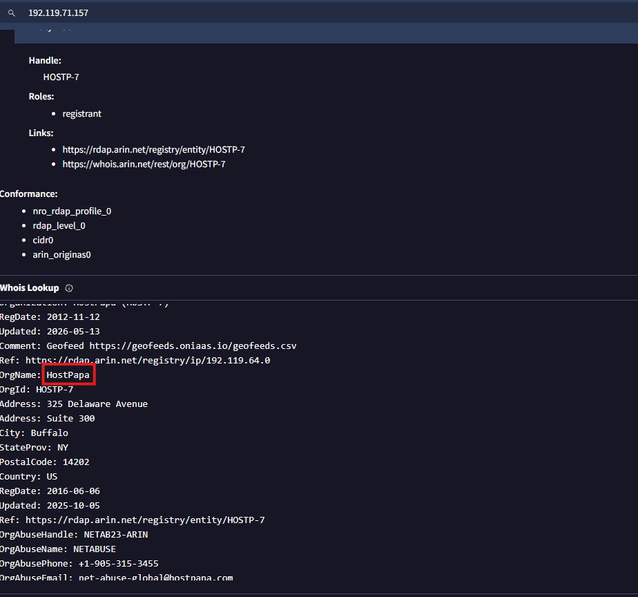

- Lookup IP in VirusTotal to acquire more details regarding the IP such as the owner name.

### Task 7 — Run an SPF record check on the Return-Path domain identified in the email headers.
What is the full SPF record for this domain?

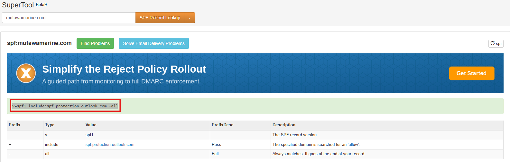

- Perform SPF record check to retrieve the full SPF record for the domain.

### Task 8 — Perform a DMARC lookup for the Return-Path domain found in the email headers.
What is the complete DMARC record for this domain?

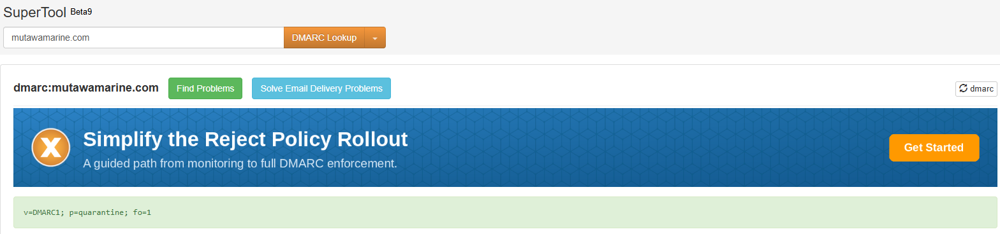

- Perform DMARC record check to retrieve the full SPF record for the domain.

### Task 9 — What is the file name of the attachment found in the email?

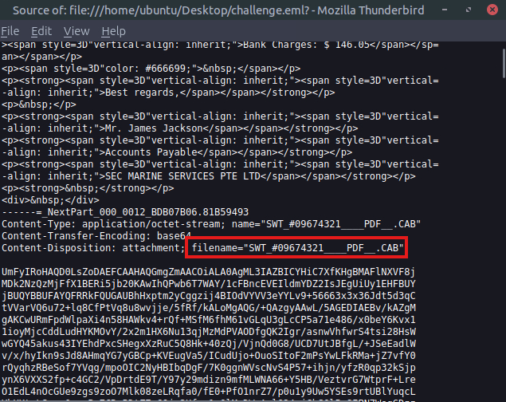

- Located attachment name using the content disposition field.

### Task 10 — Download the attachment to your virtual environment.
Using the sha256sum command, what is the SHA256 hash of the file?

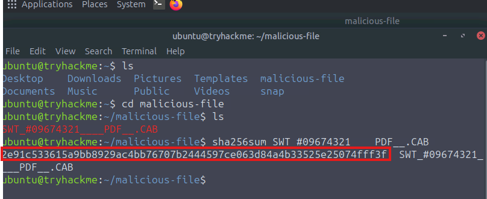

- Created a folder to put the downloaded malicious file. Use CLI to output the hash of the zip.

### Task 11 — Investigate the file hash from the previous question using VirusTotal.
What is the attachment's file size in KB (e.g., 122.31 KB)?

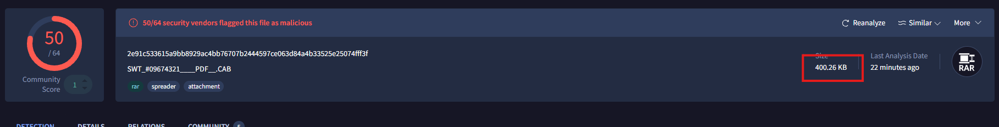

- Lookup the hash of the zip on VirusTotal to acquire information about its bit size.

### Task 12 — Continue your research on the file.
What is the actual file type of the attachment?

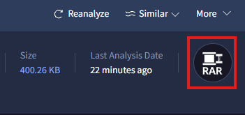

- VirusTotal indicates that is a RAR file.

---

## Key Takeaways

- **Takeaway 1** — Analyzing phishing threats requires further investigation that utilizes message source to find hidden attempts at phishing that may be incorporated by the threat actor.
- **Takeaway 2** — Importance of using 3rd party tools to reduce the time to get additional context, investigation and IOC enrichment allows for faster turnaround time as blue team operator.

### Practical Application

In a live SOC environment, utilizing all available tools at your disposal for identification, enrichment and contextualization is crucial as an SOC analyst. It allows a better understanding of the threat, how to escalate and remediate. Understanding the components of an email from delivery, makeup and contents is essential skill to any SOC analyst. This lab allows me to apply what I have learned so far in practical manner and controlled-environment.
---
