### Triage with Splunk

## Overview

Able to investigate different types of suspicious activity across a variety of assets in the environment. Knowing what to look for and which details matter most during an investigation is a key part of the role.

### Objective

- Learn how to properly investigate alerts in a SOC environment.
- Understand how to investigate brute-force attacks on Linux systems.
- Discover the persistence mechanism on Windows systems.
- Analyse a web shell on a vulnerable web server.
- Learn how to investigate alerts for three given scenarios using Splunk.

## Tools Used
| Tool | Purpose |
|---|---|
| Splunk | SIEM |

## Notes

1. 

### Initial Access Alert

### Notes/IoCs

Alert Details:
Alert Name: Brute Force Activity Detection
Time: 17/09/2025 9:00:21 AM
Target Host: tryhackme-2404
Source IP: 10.10.242.248

1. Take note of the Target Host Time and Source IP.

### Task 1 — How many failed login attempts were made on the user john.smith?
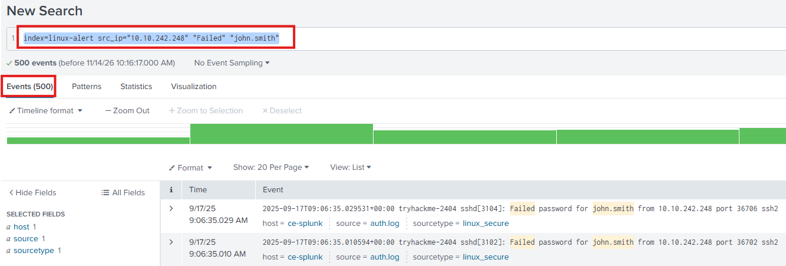

- "index=linux-alert src_ip="10.10.242.248" "Failed" "john.smith"

### Task 2 — What was the duration of the brute force attack in minutes?
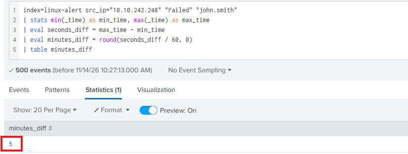

- 

### Task 3 — What username was the attacker able to privilege escalate to?
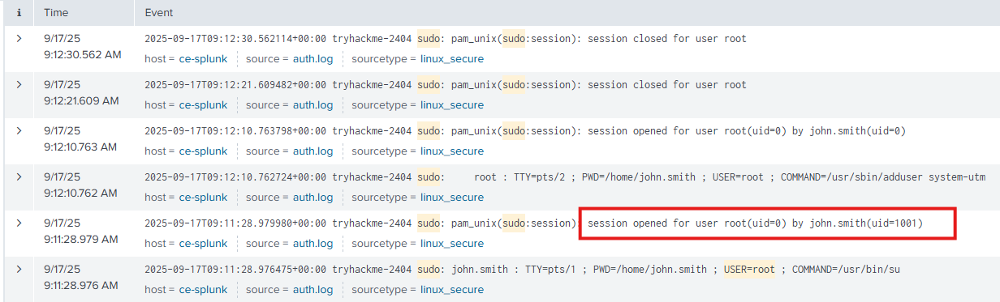

- "index=linux-alert sudo"

### Task 4 — What is the name of the user account created by the attacker for persistence?
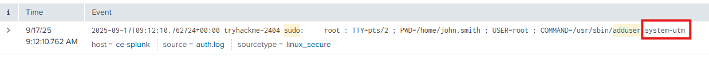

- "index=linux-alert sudo adduser"

### Persistence Alert

### Notes/IoCs

Alert Details:
Alert Name: Potential Task Scheduler Persistence Identified
Time: 30/08/2025 10:06:07 AM
Host: WIN-H015
User: oliver.thompson
Task Name: AssessmentTaskOne

1. Host and User. Work out what kind of host it is: workstation or server. This context is key before continuing. Many organisations have an Asset Inventory (sometimes in Confluence or Notion) for this, but if not, naming conventions can help.
2. Oliver Thompson is a System Engineer on Workstation Device.
3. Event ID 4698, which indicates that a scheduled task was created.

### Task 1 — What is the ProcessId of the process that created this malicious task?
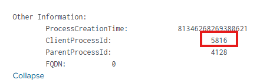

- "index="win-alert" EventCode="4698""

### Task 2 — What is the name of the parent process for the process that created this malicious task?
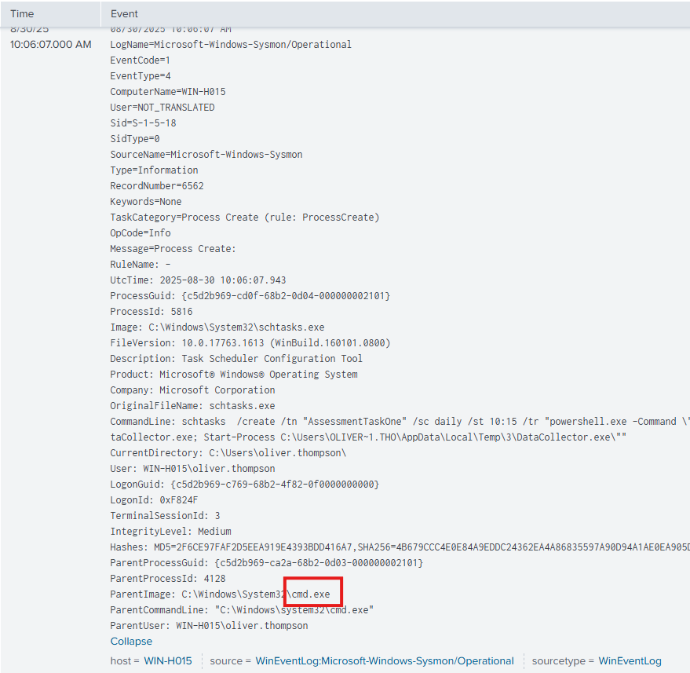

- "index="win-alert" ParentProcessId="4128""

### Task 3 — Which local group did the attacker enumerate during discovery?
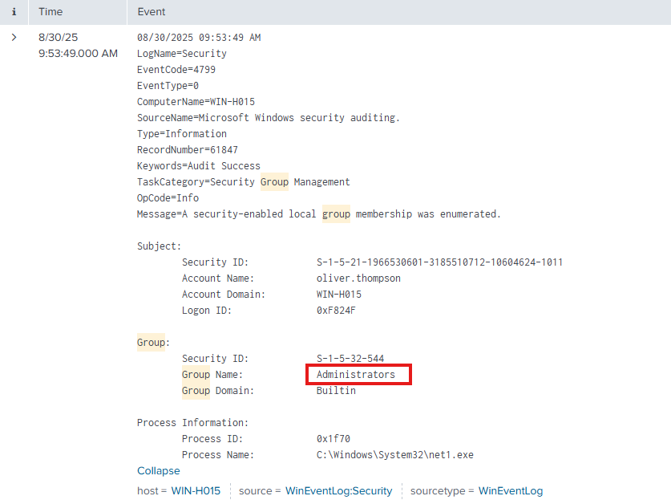

- "index="win-alert" "group" eventtype=wineventlog_security user="oliver.thompson""

### Task 4 — What is the name of the workstation from which the Threat Actor logged into this host?
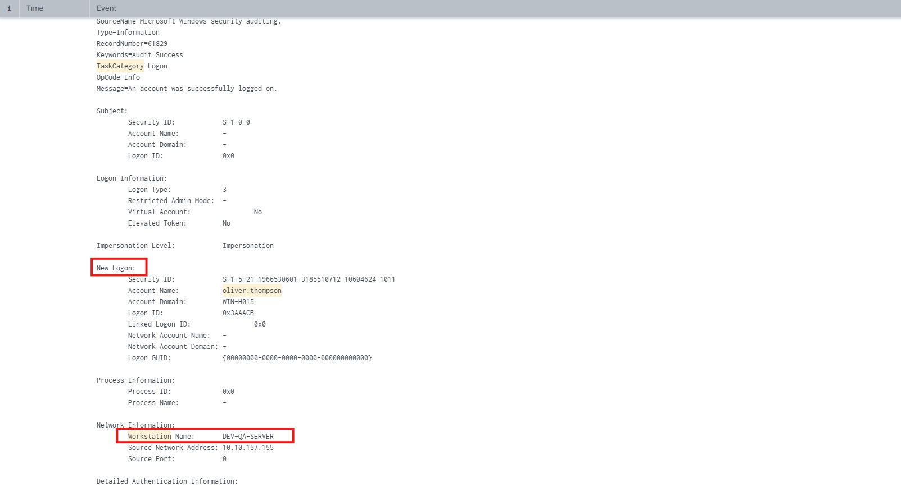

- index="win-alert" Workstation "remote logon" "oliver.thompson"

### Web Shell Alert

### Notes/IoCs

Alert Details:
Alert Name: Potential Web Shell Upload Detected
Time: 14/09/2025 09:31:51 AM
Resource: http://web.trywinme.thm
Suspicious IP: 171.251.232.40

1. The first thing of interest is the resource where the activity occurred, in this case, http://web.trywinme.thm, which is the organisation’s website hosted on the web server. The next point of interest here is the Suspicious IP address.
2. Use AbuseIPDB for this. This IP address has been flagged as malicious more than 3000 times. Let’s make a note of this.

### Task 1 — What time did the brute-force activity using Hydra begin?
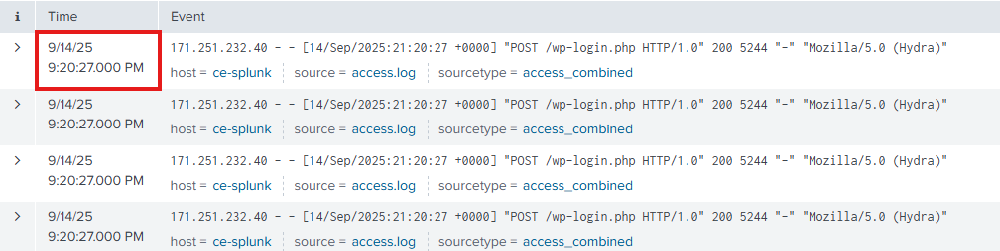

- "index="web-alert" clientip="171.251.232.40" useragent="*Hydra*" method="POST" | sort +_time"

### Task 2 — Which user agent did the attacker use when interacting with the web shell?
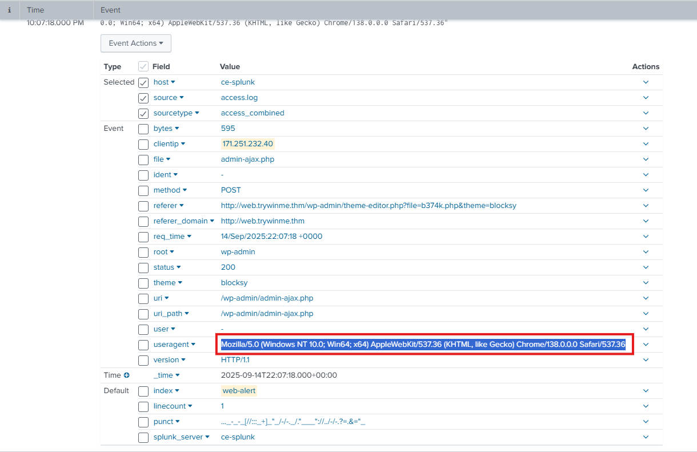

- "index="web-alert" clientip="171.251.232.40""

### Task 3 — What was the number of requests made by the attacker to the server via the web shell?
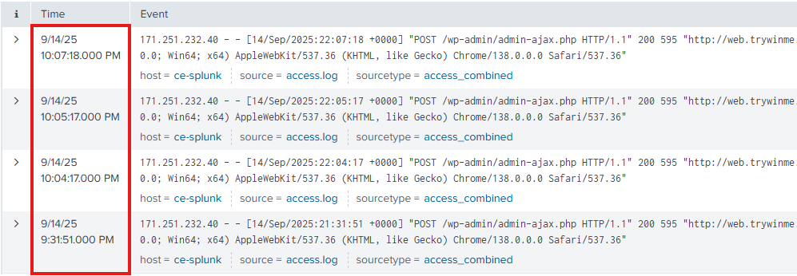

- "index="web-alert" clientip="171.251.232.40" "file=b374k" uri_path="/wp-admin/admin-ajax.php""

---
