## Wireshark 101

## Overview
Learn the basics of packet analysis through hands-on labs using Wireshark and its features. Understand the basics of what to look for during packet analysis for common protocols.

## Tools Used

| Tool | Purpose |
|---|---|
| Wireshark | Analyze packets |

---

## 1. ARP Traffic

### Task 1 — Opcode for Packet 6
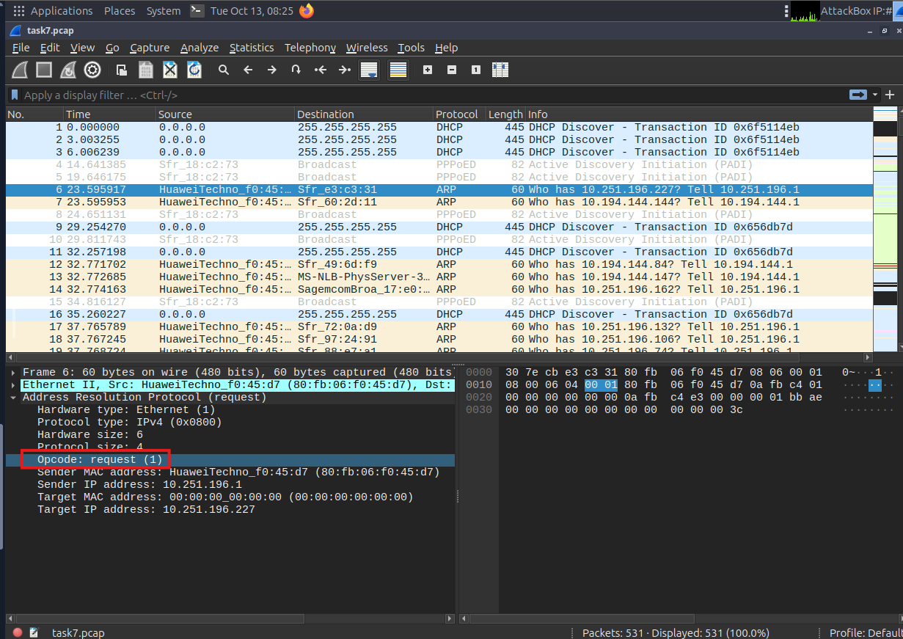

### Task 2 — source MAC Address of Packet 19
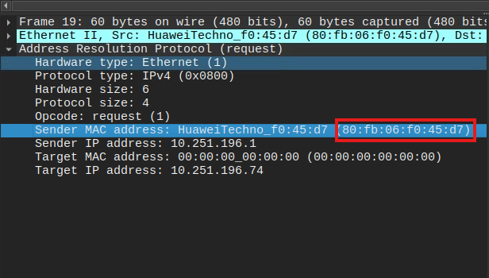

### Task 3 — 4 packets are Reply packets
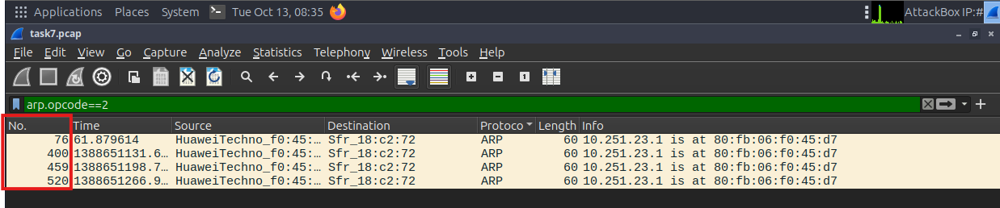

### Task 4 —  IP Address is at 80:fb:06:f0:45:d7

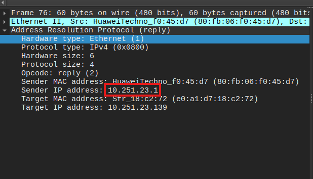

---

## Key Takeaways

- **Takeaway 1** — Use arp.opcode == 1 for request, arp.ipcode == 2 for reply. Quick filters

---
## 2. IMCP Traffic

### Task 1 — The type for packet 4
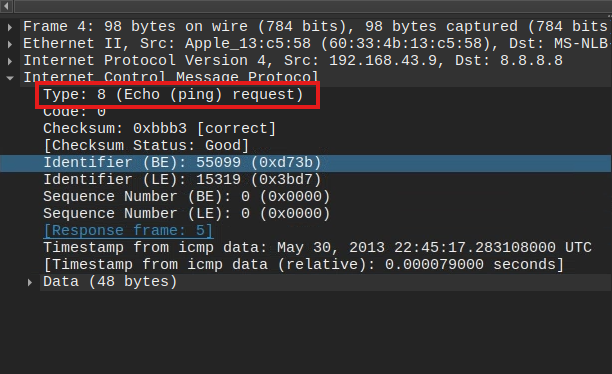

### Task 2 — Type for packet 5
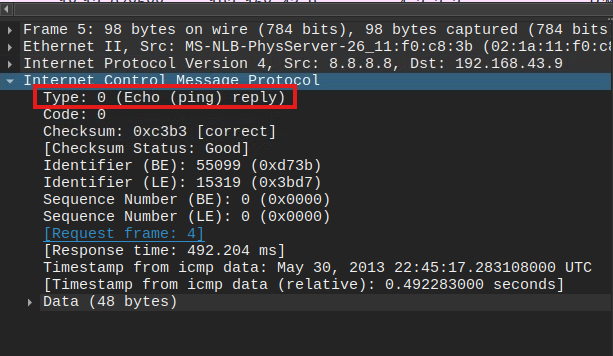

### Task 3 — Timestamp for packet 12
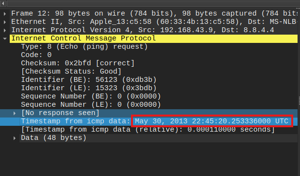

### Task 4 —  Full data string for packet 18

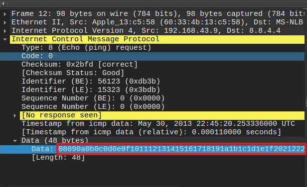

---

## Key Takeaways

- **Takeaway 1** — ICMP Type 0 (reply) and Type 8 (request). Code also matters. Worth keeping in my when analyzing packets as to what it means.

---

## 3. DNS Traffic

### Task 1 — What is queried in Packet 1
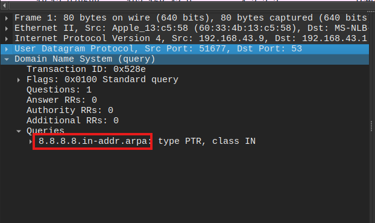

### Task 2 — What site is being queried in packet 26
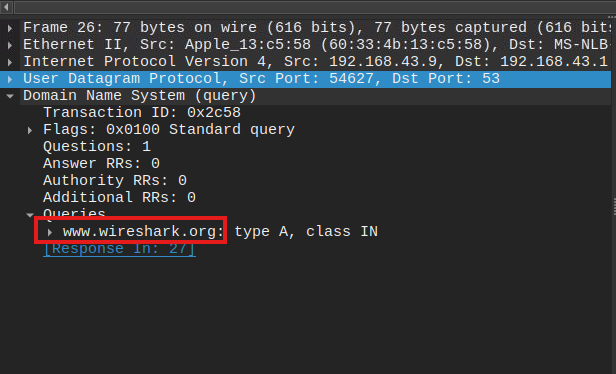

### Task 3 — Transaction ID for packet 26
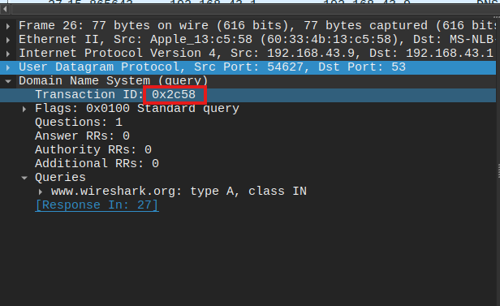

---

## Key Takeaways

- **Takeaway 1** — Keep in mind Query-Response, DNS-Servers Only and UDP.

---

## 4. HTTP Traffic

### Task 1 — Percent of packets for DNS
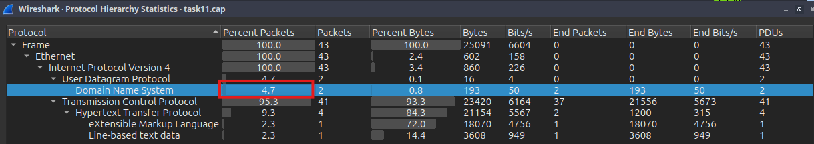

### Task 2 — Endpoints that ends with .237
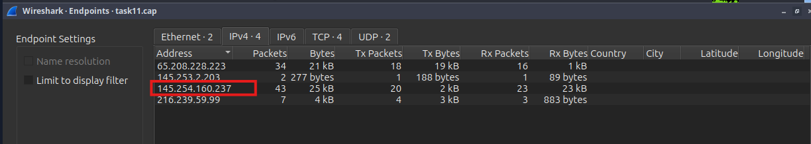

### Task 3 — user-agent listed in packet 4
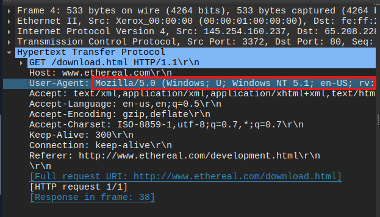

### Task 4 —  Full request URL for packet 18

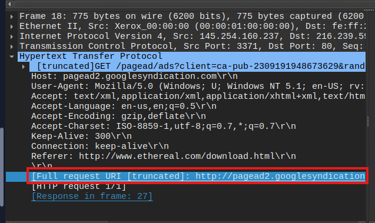

### Task 5 —  Domain name and full request URL for packet 38

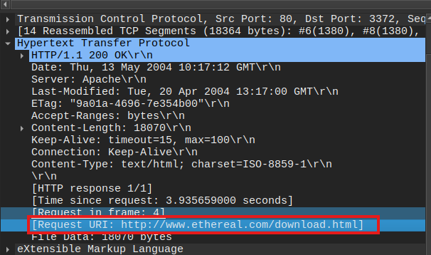

---

## Key Takeaways

- **Takeaway 1** — Can use Protocol Heirarchy to organize present protocols for threat hunting to identify discrepancies in packet captures. (Statistic > Protocol Hierarchy). To organize all requested URLs in the capture use Export Objects HTTP. (File > Export Object > HTTP). To organize by Endpoints within the capture use Endpoints in Statistics (Statistics > Endpoints)

---

## 5. HTTPS Traffic

### Task 1 — Full request URI for packet 31
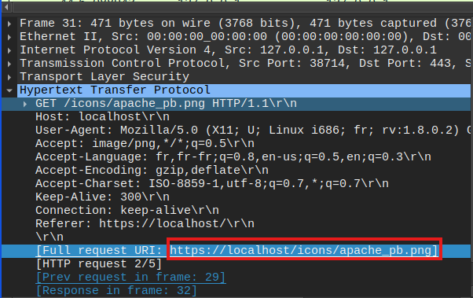

### Task 2 — Full request URI for packet 50
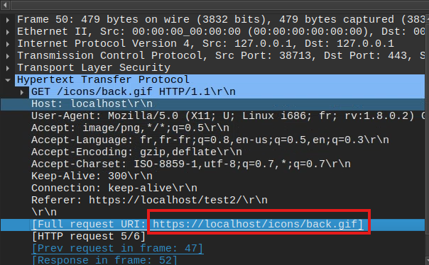

### Task 3 — User-Agent listed in packet 50
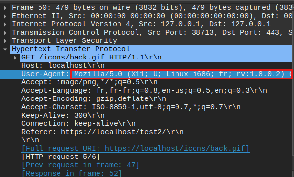

---

## Key Takeaways

- **Takeaway 1** — Encrypted packets can be viewed by using RSA key. (Edit > Preferences > Protocols > TLS >  [+])

---

## 6. Wireshark Scenario 1 : Zerologon PCAP and Secretsdump SMB

### Task 1 — Identifying the attacker and Connection Analysis
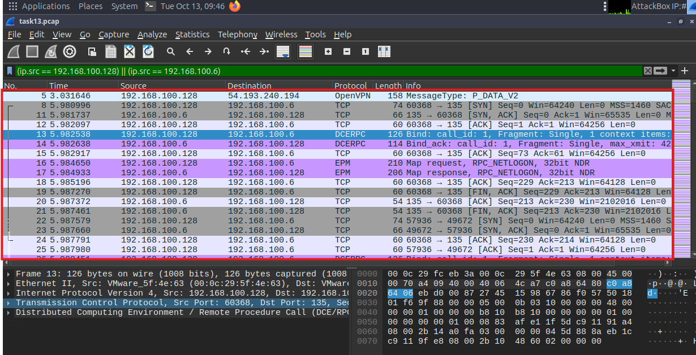
- This is a short activity that requires filter of the known domain controller and the suspicious IP. This is was aided by the background knowledge of Zerologon exploit uses multiple RPC connections, and DCERPC requests to change the machine account password.

### Task 2 — Secretsdump SMB Analysis
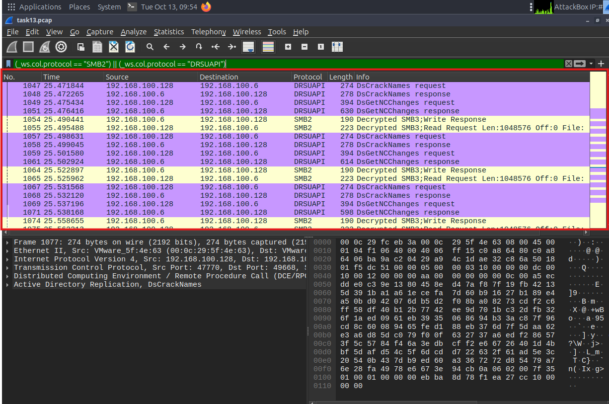

- This is a short activity that requires filter to identify the abuse of protocols by an exploit. 
---

## Key Takeaways

- **Takeaway 1** — Packet analysis requires familiarity, practice and extensive knowledge of its contents. The data can be overwhelming, there must be a plan of action before beginning investigation.
- **Takeaway 2** — Utilize Wireshark features such as display filters, export objects and statistics to quicken the process to detect anomalies and threat hunting.

### Practical Application

Packet analysis is a crucial aspect in cybersecurity and it offers a wealth information of an attack. Understanding and mastering the know-hows of packet analysis will ensure a significant edge in defensive capabilities. In a live SOC environment, this skillset will be invaluable. 

---

